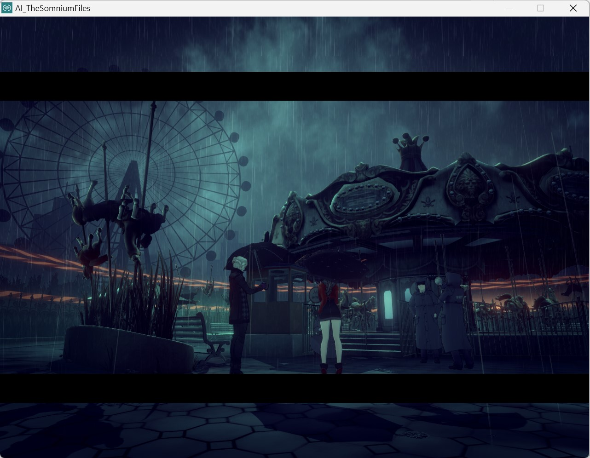
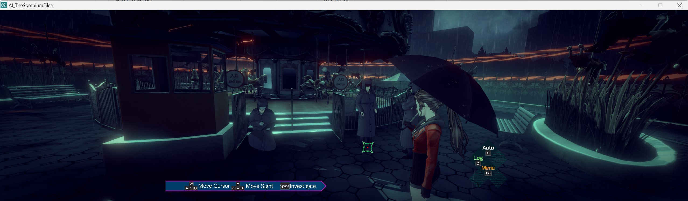

# AI-THE-SOMNIUM-FILES-Any-Aspect-Ratio

## Install

1. Close the game. Back up `AI_TheSomniumFiles_Data\Managed\Assembly-CSharp.dll`
   as `Assembly-CSharp.dll.ai1-original.bak`.
2. Extract the ZIP beside `AI_TheSomniumFiles.exe`, merging folders.
3. Launch normally through Steam and its configuration tool.

## Custom Aspect Ratio

Edit `AI1_ARFix.ini`, then restart. Defaults are 1280x800 (16:10):

```ini
[Resolution]
Width = 1280
Height = 800
Fullscreen = false
PreserveHUDAspect = true
```

`PreserveHUDAspect = true` keeps HUD proportions at all aspect ratios.

Fixes 3D/AI Sight selection and menu reopening after minimize/restore.

Tested on Windows at 4:3 and ultrawide.



