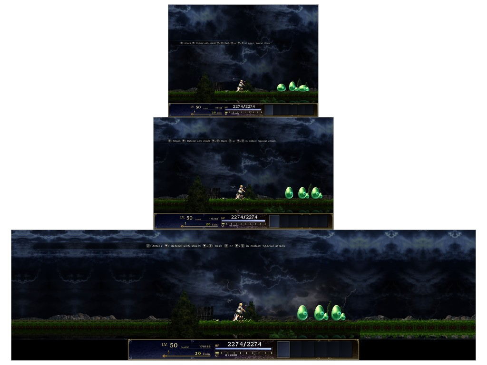

# ASTLIBRA Revision-Any-Aspect-Ratio

[](https://github.com/TLin-Y/SteamAnyAspectRatioMods) [](https://ko-fi.com/lin66961)

Runs the game at any aspect ratio without black bars, in a borderless window.

Taller screens (16:10, 4:3) show more sky above, with the HUD at the bottom edge.
Wider screens (21:9, 32:9) are **WIP**: the extra width repeats the nearest scenery, so edges can look mirrored.

## Install

Extract `xinput1_4.dll`, `ASTLIBRA_ARFix.asi`, and `ASTLIBRA_ARFix.ini` into the game folder, beside `ASTLIBRA.exe`.

In the game's OPTION menu keep:

- Screen Mode: `WINDOW`
- Direct 3D: `9.0`
- Resolution: `1280 x 720` on Steam Deck, or the one closest to your screen height

## SteamOS / Winlator

Add the launch option:

```text
WINEDLLOVERRIDES="xinput1_4=n,b" %command%
```

## Custom Aspect Ratio

Edit `ASTLIBRA_ARFix.ini` and restart the game:

```ini
[Display]
Width = 1280
Height = 800
Borderless = true
```

The default is 16:10 (1280x800). `Width = 0` and `Height = 0` use the full monitor resolution.

## Demo


