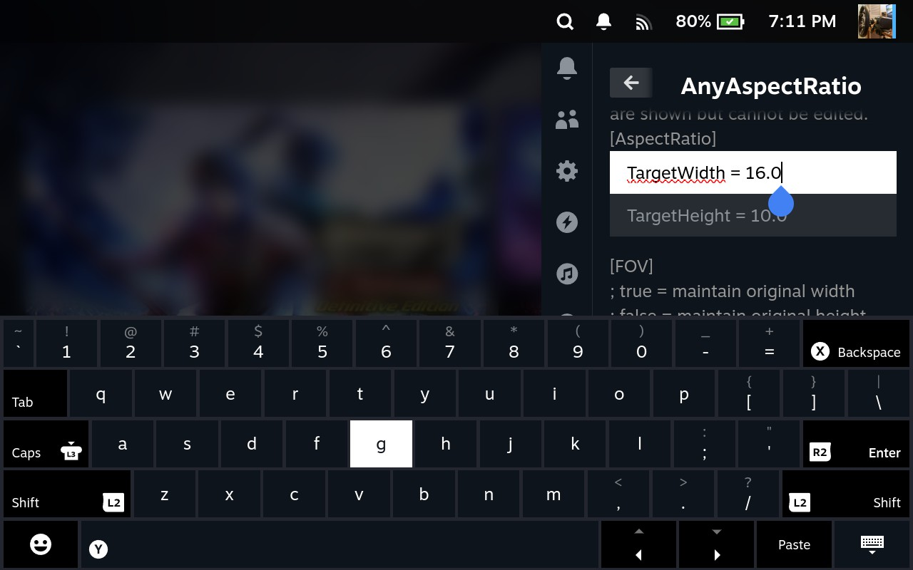
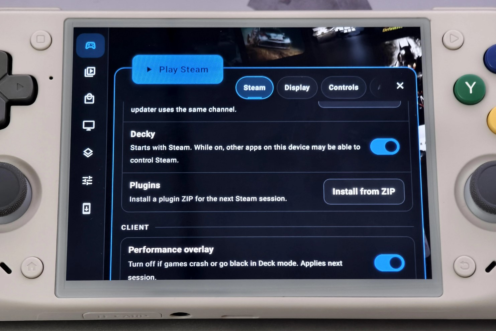

# AnyAspectRatio for Decky

Play your games in full screen at any aspect ratio (32:9 / 21:9 / 16:10 / 4:3 / 3:2 etc.) on Steam Deck and SteamOS.

This Decky plugin finds your supported games (in every Steam library, including the microSD card) and applies their aspect-ratio fixes in one tap.

| Apply a fix per game                     | Edit its settings                                 |
| ---------------------------------------- | ------------------------------------------------- |
|  |  |

## Install

**Requires [Decky Loader](https://decky.xyz).**

**DeckyHub (recommended):** open [DeckyHub](https://deckyhub.com/) from the Decky menu, search for **AnyAspectRatio**, and install it.

**From ZIP:**

1. Download `AnyAspectRatio-2.0.0.zip` from the [latest release](https://github.com/TLin-Y/SteamAnyAspectRatioMods/releases/latest) and put it on the Deck.
2. In Decky, open **Settings → General** and turn on **Developer mode**.
3. Open **Settings → Developer → Install Plugin from ZIP** and pick the zip.
4. Open **AnyAspectRatio** and press **Scan for supported games**.

On DroidDeck, use Steam **Settings → Plugins → Install from ZIP**:

To update, install the newer zip the same way.

## How the mods work

Each mod is a small DLL that patches the game engine. Depending on the game, it adds a custom resolution, fixes the aspect ratio and adjusts the FOV, so you see the same view as at 16:9 with more of the scene around it.

Adjust your system resolution and in-game resolution so the mod works properly:

## Good to know

- Fixes are made for the Steam version of each game. A game update may need a new fix.
- Fixes by **Lyall** are shipped as-is and not all tested by me. If one misbehaves, press **Remove** and tell me which game.
- Anti-cheat or online games: use fixes at your own risk.
- This plugin has zero tracking or upload code, whether offline mode is on or off.
- **Settings → Offline mode** blocks all internet use. Import the offline mods pack from the release page first.
- Uninstalling the plugin keeps applied fixes. Press **Remove** on each game first if you want them gone.

## License

MIT, see [LICENSE](../LICENSE). Third-party notices: [THIRD_PARTY_NOTICES.md](./THIRD_PARTY_NOTICES.md).
