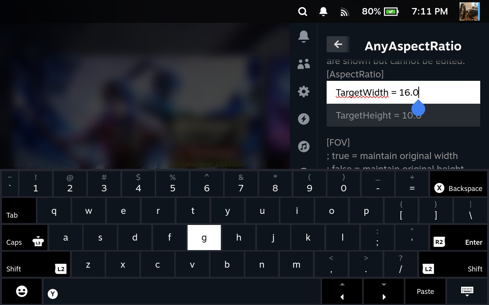

# AnyAspectRatio for Decky

Play your games at fullsceen 16:10 on Steam Deck and SteamOS.

This Decky Loader plugin finds your supported games and applies aspect-ratio fixes in one tap, with the Steam launch options set for you

| Apply a fix per game                     | Edit its settings                                 |
| ---------------------------------------- | ------------------------------------------------- |
|  |  |

## Install

Requires a Steam Deck (or SteamOS) with [Decky Loader](https://decky.xyz).

1. Download `AnyAspectRatio-1.4.0.zip` from the [latest release](https://github.com/TLin-Y/SteamAnyAspectRatioMods/releases/latest).
2. Put the zip on the Deck (for example in `Downloads`).
3. In Game Mode, open Decky (`...` button), then **Settings → General** and turn on **Developer mode**.
4. Open **Settings → Developer → Install Plugin from ZIP**, pick the zip, and confirm.
5. Open **AnyAspectRatio** in the Decky menu and use **Scan Steam libraries**.

To update, install the newer zip the same way. To remove, uninstall from the Decky plugin list.

## Tabs

- **Games**: lists your games that have a mod, including non-Steam shortcuts. Apply or remove a mod per game, edit its settings, or read its ReadMe. Fixes that need manual steps are grouped under **Manual fixes** with a ReadMe button only.
- **Mods**: shows who made the mods. Two buttons:
  - **Import repository zip...**: install every mod without internet. Download `AnyAspectRatio-Offline-1.4.0.zip` from the release page, put it in the Deck's `Downloads` folder, then pick it here. It holds only the mod files, no source code.
  - **Delete all local files and caches**: frees the space used by imported or downloaded files. Your settings and already-applied mods are kept.
- **Settings**: an **Offline mode** switch, where mods come from, an optional folder of your own mod zips, and **Update** to fetch the newest mod list.

### Offline mode and privacy

Turn on **Settings → Offline mode** and the plugin never connects to the internet: no catalog refresh at startup, no downloads, and the author links are disabled. The switch is saved, so it stays on after a reboot. To use it, import the **Offline Pack** (`AnyAspectRatio-Offline-1.4.0.zip`) once under **Mods → Import repository zip...**; it contains only the mod files and READMEs, no source code. Without the pack, mods install only from your own mod folder. Offline mode covers this plugin only, not Decky Loader or Steam.

## License

MIT, see [LICENSE](../LICENSE). Third-party notices: [THIRD_PARTY_NOTICES.md](./THIRD_PARTY_NOTICES.md).
