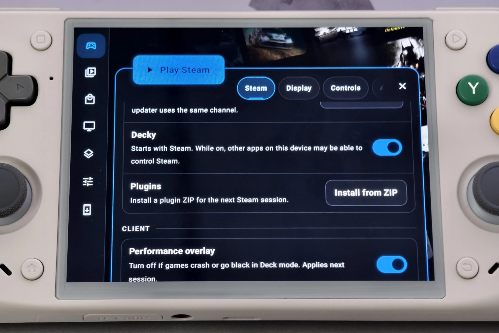

# AnyAspectRatio for Decky

Play your games in full screen at any aspect ratio (48:9 / 32:9 / 21:9 / 16:10 / 4:3 / 3:2 etc.) on Steam Deck & SteamOS.

This Decky Loader plugin finds supported games, applies aspect-ratio fixes, and helps set Steam launch options.

| Apply a fix per game                     | Edit its settings                                 |
| ---------------------------------------- | ------------------------------------------------- |
|  |  |

## Install

Requires a Steam Deck (or SteamOS) with [Decky Loader](https://decky.xyz).

1. Download `AnyAspectRatio-1.8.0.zip` from the [latest release](https://github.com/TLin-Y/SteamAnyAspectRatioMods/releases/latest).
2. Put the zip on the Deck (for example in `Downloads`).
3. In Game Mode, open Decky (`...` button), then **Settings → General** and turn on **Developer mode**.
4. Open **Settings → Developer → Install Plugin from ZIP**, pick the zip, and confirm.
5. Open **AnyAspectRatio** in the Decky menu and use **Scan Steam libraries**.

On DroidDeck, open Steam **Settings → Plugins → Install from ZIP** and select the plugin zip:

To update, install the newer zip the same way. To remove, uninstall from the Decky plugin list.

## Good to know

- Fixes by **Lyall** are shipped as-is and haven't all been tested by me. If one misbehaves, press Remove and tell me which game.
- Some fixes are for specific game versions. If a game updates, a fix may need a new release.
- Anti-cheat or online games: use fixes at your own risk.
- Uninstalling the plugin deletes its downloaded zips and caches, but keeps applied fixes and launch options. Press **Remove** on each game first if you want them gone.

## What it does

- **100+ games supported.**
- **Made for the SteamOS.** My fixes default to **16:10 (1280x800)**, matching the SteamDeck screen.
- **Finds your games everywhere.** Scans every Steam library, including the microSD card.
- **Non-Steam games work too.** It is matched by its exe name.
- **Edit settings in the plugin.** Change resolution, aspect ratio or FOV right from **Game Mode**. Changes save automatically.
- **Offline friendly.** Import the repository zip once, or point it at a folder of your own mod zips.

## Tabs

- **Games**: scan for supported games, apply or remove fixes, edit settings, and read instructions.
- **Mods**: update the catalog, see mod credits, download or import an offline pack, or delete local files and caches. Deleting local files keeps your settings and applied mods.
- **Settings**: set the resolution written into supported mod INIs when applying (enter both dimensions and choose **Save resolution**). After changing it, **Update current** is highlighted as a reminder to scan installed mods and update supported INIs using the saved resolution. You can also change mod sources, enable offline mode, or check for updates.

### Offline mode and privacy

Turn on **Settings → Offline mode** to prevent the plugin from connecting to the internet. Before going offline, choose **Mods → Download offline pack**, or download `AnyAspectRatio-Offline-Mods-1.8.0.zip` from the release page and use **Mods → Import offline mods pack**. You can also use your own local mod archives. Offline mode applies to this plugin only, not Decky Loader or Steam.

## License

MIT, see [LICENSE](../LICENSE). Third-party notices: [THIRD_PARTY_NOTICES.md](./THIRD_PARTY_NOTICES.md).
