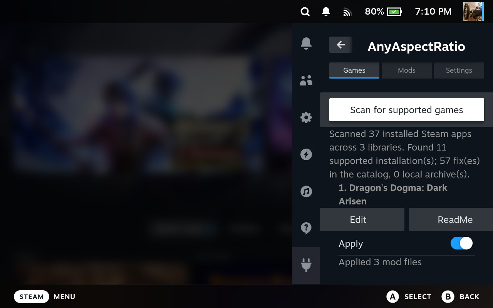

# AnyAspectRatio for Steam Deck v1.5.0: play at full-screen 16:10, one tap per game

Tired of black bars, stretched UI, or cropped cameras on your Deck's 16:10 screen? **AnyAspectRatio** is a Decky Loader plugin that finds the games you own, installs the right aspect-ratio fix, and sets the Steam launch options for you. No file copying, no terminal.

## New in 1.5.0

- **Better game matching.** A unique catalogued executable can identify a game when its Steam folder name changes, or when it is a non-Steam shortcut. Ambiguous executable names are skipped with a warning.
- **Clearer labels.** **By Exe** marks executable matches, **Custom** marks local archives, and **New** marks a catalog archive whose checksum differs from the version last fully applied by the plugin. Use **Apply update** to install it.
- **Game layout warnings.** Missing expected executables or catalogued destination folders are reported so you can check the game's files.
- **Download mods for offline use.** The Mods tab can download and import the latest release's offline pack.
- **Expedition 33 and Ninja Gaiden Sigma 2.** Corrected Expedition 33's catalog paths and included all Black V18 files for Ninja Gaiden Sigma 2.

## What it does

- **One-tap Apply / Remove.** Pick a game, press Apply. Press Remove to undo it cleanly.
- **Launch options handled for you.** Fixes that need a Proton DLL override get the right Steam launch option automatically. If you decline or it fails, the files are still installed.
- **100+ games supported.** Our own fixes (Dark Souls III, Resident Evil 2/3/4/7/Village, Monster Hunter Rise, Ori, Tales of Arise, Dynasty Warriors, Warriors Orochi, Final Fantasy XIII, Visions of Mana, Ninja Gaiden Sigma 2 and more) plus fixes by [Lyall](https://codeberg.org/Lyall), redistributed unchanged. Full list with versions and dates: [main README](https://github.com/TLin-Y/SteamAnyAspectRatioMods#game-mods).
- **Made for the Deck.** Our own fixes default to **16:10 (1280x800)**, matching the Deck screen.
- **Finds your games everywhere.** Scans every Steam library, including the microSD card. If a game was moved and exists in two places, the bigger install wins.
- **Non-Steam games work too.** Added a GOG or DRM-free copy as a non-Steam shortcut? Point it directly at a unique catalogued executable. Wrapper scripts cannot be matched safely.
- **Edit settings in the plugin.** Change resolution, aspect ratio or FOV right from Game Mode. Changes save automatically.
- **Read the ReadMe in-game.** Each fix's instructions are one button away, and the screen shows which game folder it resolved.
- **Safe by design.**
  - Only the files listed for that mod are touched.
  - If a file differs from the mod's, it asks before replacing it.
  - When removing, it can keep your edited settings file.
- **Manual fixes section.** A few fixes can't be installed automatically. They are listed with a ReadMe button, so you can still see which of your games have one.
- **Always fresh.** The mod list refreshes when the plugin starts (unless Offline mode is on).
- **Full offline mode.** One switch in Settings locks the plugin so it never connects to the internet: no startup refresh, no downloads, no tracking. It stays on after a reboot. Great if you care about privacy.
- **Offline friendly.** Grab the **Offline Pack** zip from the Assets (all mods, no source code), and import it once under **Mods → Import repository zip**. After that, nothing needs the internet. You can also point the plugin at a folder of your own mod zips.

## Install (about 2 minutes)

You need a Steam Deck (or SteamOS) with [Decky Loader](https://decky.xyz).

1. Download **AnyAspectRatio-1.5.0.zip** from the Assets below and put it on your Deck (for example in `Downloads`).
2. In Game Mode open Decky (the `...` button), go to **Settings → General** and turn on **Developer mode**.
3. Go to **Settings → Developer → Install Plugin from ZIP**, pick the zip and confirm.
4. Open **AnyAspectRatio** in the Decky menu, go to the **Mods** tab, press **Import repository zip...** and pick **AnyAspectRatio-Offline-Mods-1.5.0.zip** (also in the Assets, about 500 MB). This installs every mod without internet. Skip this step if your Deck is online: the plugin downloads the mod list itself.
5. Press **Scan Steam libraries**.

To update, install the newer zip the same way. To remove, uninstall it from the Decky plugin list.

## Good to know

- **Full-stretch fixes** (Monster Hunter Rise, Resident Evil 2/3/4/7/Village, Warriors Orochi 3): set the game's in-game resolution to **1280x720** and display scaling to **Stretch**, otherwise the picture will not stretch to fill the screen.

- Third-party fixes haven't all been tested by us. If one misbehaves, press Remove and tell us which game.
- Existing installs without a recorded applied archive hash are not labeled **New** until a full Apply records their version.
- Some fixes are for specific game versions. If a game updates, a fix may need a new release.
- Anti-cheat or online games: use fixes at your own risk.

## Credits and support

Huge thanks to [Lyall](https://codeberg.org/Lyall) ([Patreon](https://www.patreon.com/Wintermance) | [Ko-fi](https://ko-fi.com/W7W01UAI9)), ThirteenAG (Ultimate ASI Loader), and all the mod authors who make this possible. See our [thanks to external mod authors](../external/THANKS.md).

If this helps you, you can support me on [Ko-fi](https://ko-fi.com/lin66961). Bug reports and game requests: open an issue on [GitHub](https://github.com/TLin-Y/SteamAnyAspectRatioMods/issues).
