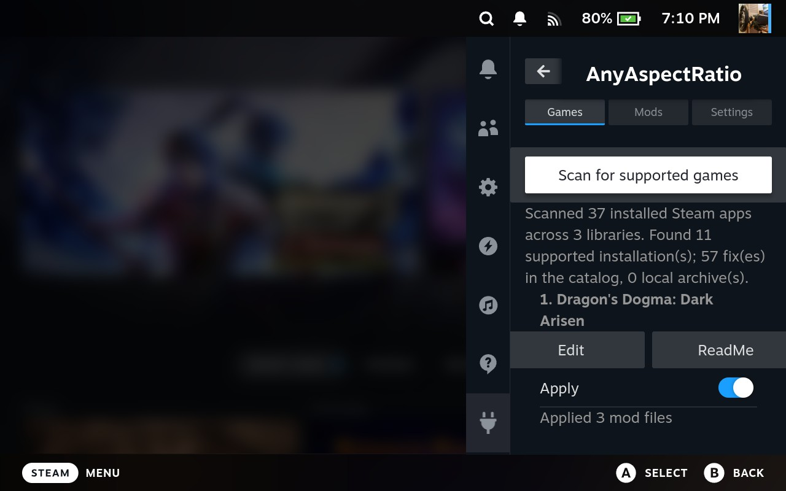

# AnyAspectRatio v2.1.0: one tap per game on Steam Deck, now also on Windows, macOS and Linux

## New in 2.1.0

- **New fixes:** Bayonetta, CRISIS CORE -FINAL FANTASY VII- REUNION, DYNASTY WARRIORS 6, Emperor: Rise of the Middle Kingdom, FINAL FANTASY XV WINDOWS EDITION, Hollow Knight, Hollow Knight: Silksong, Life is Strange Remastered, Life is Strange: Before the Storm Remastered, Life is Strange 2, Plants vs. Zombies GOTY Edition (16:9; back up your save first, see its ReadMe), STAR OCEAN THE SECOND STORY R and The Adventures of Elliot: The Millennium Tales.
- **Updated:** DAVE THE DIVER, Dead Cells, Devil May Cry 4 Special Edition, Devil May Cry 5, DmC Devil May Cry, Dynasty Warriors 3: Complete Edition Remastered, DYNASTY WARRIORS 7 and 8, Dynasty Warriors: Origins, Final Fantasy XIII, both Guacamelee! games, Ninja Gaiden Sigma 2, Nioh: Complete Edition, both Ori games, Persona 5 Royal, Resident Evil 2/3/4/7/Village/Requiem, SAMURAI WARRIORS: Spirit of Sanada, Warriors Orochi 3 and 4 Ultimate and Ys VIII: Lacrimosa of DANA.
- **Removed:** Bloodstained: Ritual of the Night and Detroit: Become Human.
- **Desktop app updates.** Check for a new version in the app and open its download.
- **Scan progress** in the Games tab, and mods grouped by author in the Mods tab.
- **Clearer labels.** Undertale and Plants vs. Zombies now show **(4:3 -> 16:9 Fix)** in the Games tab.
- **Safer Apply.** If Apply fails partway, the original files it had replaced are put back.
- **Cleaner Remove.** Remove now works when the game's original files are read-only on Windows, and restored files keep their permissions.

## New in 2.0.0

- **Desktop app.** The same plugin as an app for Windows, macOS (Apple silicon) and Linux. Download one file and run it; nothing else to install. On macOS it sets the Wine override inside your CrossOver or Whisky bottle for you. See the [desktop guide](https://github.com/TLin-Y/SteamAnyAspectRatioMods/blob/main/AnyAspectRatioDesktop/README.md).
- **New fixes:** ASTLIBRA Revision, Brotato, CODE VEIN, Detroit: Become Human, Devil May Cry 4 Special Edition, DmC Devil May Cry, DragonSword: Awakening, Onimusha: Way of the Sword and Resident Evil Requiem.
- **Updated:** Dynasty Warriors: Origins, Monster Hunter Rise, NINJA GAIDEN Sigma, Ninja Gaiden Sigma 2, NINJA GAIDEN 3: Razor's Edge, Palworld, Pentiment, Persona 4 Golden, Persona 5 Royal, Resident Evil 2/3/4/7/Village and Trials of Mana.
- **Removed:** the RESONANCE OF FATE/END OF ETERNITY ENHANCED REMASTER fix.
- **Game folders.** Games outside Steam can be added under **Settings → Game folders**: a game's folder, or a folder that holds several games.
- **Filter games by name** in the Games tab.
- **See each step.** While a fix is applied or removed, the game's card shows what it is doing.

## New in 1.9.0

- **New fixes:** Apollo Justice: Ace Attorney Trilogy, Daemon X Machina: Titanic Scion, Dead Cells, Devil May Cry 5, FINAL FANTASY RESONANCE, FINAL FANTASY X/X-2 HD Remaster, KINGDOM HEARTS -HD 1.5+2.5 ReMIX-, KINGDOM HEARTS III, Nioh: Complete Edition, PRAGMATA, Persona 4 Golden, Phoenix Wright: Ace Attorney Trilogy, Yakuza 0 and Yakuza Kiwami (Legacy).
- **Updated:** the DragonTweak fixes for the Yakuza, Like a Dragon and Judgment games, AI: THE SOMNIUM FILES, DAVE THE DIVER, Final Fantasy XIII, Master Detective Archives: RAIN CODE Plus, Ninja Gaiden Sigma 2, Ori and the Blind Forest, Pentiment, Persona 5 Royal, SANABI, Trials of Mana and Ys VIII: Lacrimosa of DANA.
- **Touch-friendly editing.** Settings values and INI lines now open in a dialog, so the on-screen keyboard no longer drops key presses, and the panel stays where you were after the dialog closes.
- **Tidier Settings.** The mod source, local mod folder and Reset to defaults moved under **More settings**. **Update current** shows a short summary and only lists mods that need attention.
- **Simpler offline setup.** The in-plugin offline pack download is gone. Download the offline pack from the release page and use **Mods → Import offline mods pack**.
- **Scans only when you ask.** Changing settings or updating the catalog no longer rescans your games; the Games tab tells you when a new scan would show changes.
- **Cleaner uninstall.** Uninstalling the plugin deletes its downloaded offline pack and caches. Your settings and the fixes installed in your games stay.
- **Under the hood.** A large clean-up of the plugin's backend and faster archive caching. Nothing changes in how you use it.

## New in 1.8.0

- **AI: THE SOMNIUM FILES fix.** Adds custom aspect-ratio support, with an option to preserve HUD proportions.
- **Safe original-file backup and restore.** Applying a fix can preserve catalogued game files beside their replacements; Remove restores the originals.
- **Large offline packs split into parts.** Download all parts together in the plugin, or keep them in one folder and select any part to import.

Tired of black bars, stretched UI, or cropped cameras on your Deck's 16:10 screen? **AnyAspectRatio** is a Decky Loader plugin that finds the games you own, installs the right aspect-ratio fix, and sets the Steam launch options for you. No file copying, no terminal.

## New in 1.7.0

- **Set your mod resolution.** Save a width and height in Settings to use for supported mod INIs when applying fixes. The default is 1280x800.
- **Update current mods.** Scan installed mods and update supported resolution fields using the saved dimensions. Review the confirmation before overwriting values; zero-valued defaults are kept.
- **Clearer game labels.** Games that require display stretching or manual installation are marked in the Games tab.
- **Catalog updates in Mods.** Update the catalog from the top of the Mods tab.
- **INI editing on restricted filesystems.** If preserving file permissions is denied, the plugin can still attempt to save the INI; permission fallback details are logged.

### Games added or updated since 1.6.0

- **New fixes:** Bloodstained: Ritual of the Night, DAVE THE DIVER, Guacamelee! 2, Guacamelee! Super Turbo Championship Edition, Rayman Legends, SANABI, SONIC X SHADOW GENERATIONS, and Ys VIII: Lacrimosa of DANA.
- **Updated:** Absolum now uses our fix; both Guacamelee! fixes were updated after their initial addition. Ori and the Blind Forest: Definitive Edition has an additional manual download. The Prince of Persia: The Lost Crown listing now warns of reported Steam Deck crashes.
- **Documentation:** Corrected the custom aspect-ratio instructions for Resident Evil 2 Remake and Warriors Orochi 3 Ultimate.

## What it does

- **One-tap Apply / Remove.** Pick a game, press Apply. Press Remove to undo it cleanly.
- **Launch options handled for you.** Fixes that need a Proton DLL override get the right Steam launch option automatically. If you decline or it fails, the files are still installed.
- **100+ games supported.** Our own fixes (Dark Souls III, Resident Evil 2/3/4/7/Village, Monster Hunter Rise, Ori, Tales of Arise, Dynasty Warriors, Warriors Orochi, Final Fantasy XIII, Visions of Mana, Ninja Gaiden Sigma 2 and more) plus fixes by [Lyall](https://codeberg.org/Lyall), redistributed unchanged. Full list with versions and dates: [main README](https://github.com/TLin-Y/SteamAnyAspectRatioMods#game-mods).
- **Made for the Deck.** Our own fixes default to **16:10 (1280x800)**, matching the Deck screen.
- **Finds your games everywhere.** Scans every Steam library, including the microSD card. If a game was moved and exists in two places, the bigger install wins.
- **Non-Steam games work too.** Added a GOG or DRM-free copy as a non-Steam shortcut? Point it directly at a unique catalogued executable. Wrapper scripts cannot be matched safely.
- **Edit settings in the plugin.** Change resolution, aspect ratio or FOV right from Game Mode. Changes save automatically.
- **Read the ReadMe in-game.** Each fix's instructions are one button away, and the screen shows which game folder it resolved.
- **Safe by design.**
  - Only the files listed for that mod are touched.
  - If a file differs from the mod's, it asks before replacing it.
  - When removing, it can keep your edited settings file.
- **Manual fixes section.** A few fixes can't be installed automatically. They are listed with a ReadMe button, so you can still see which of your games have one.
- **Always fresh.** The mod list refreshes when the plugin starts (unless Offline mode is on).
- **Full offline mode.** One switch in Settings locks the plugin so it never connects to the internet: no startup refresh, no downloads, no tracking. It stays on after a reboot. Great if you care about privacy.
- **Offline friendly.** Download or import the **Offline Pack** from the Mods tab to use its fixes without internet. You can also point the plugin at a folder of your own mod zips.

## Install (about 2 minutes)

You need a Steam Deck (or SteamOS) with [Decky Loader](https://decky.xyz).

1. Download **AnyAspectRatio-2.1.0.zip** from the Assets below and put it on your Deck (for example in `Downloads`).
2. In Game Mode open Decky (the `...` button), go to **Settings → General** and turn on **Developer mode**.
3. Go to **Settings → Developer → Install Plugin from ZIP**, pick the zip and confirm.
4. Open **AnyAspectRatio** in the Decky menu, go to the **Mods** tab, press **Import offline mods pack** and pick **AnyAspectRatio-Offline-Mods-2.1.0.zip** (also in the Assets, about 500 MB). If the pack has numbered parts, keep them together in one folder and select any part. Skip this step if your Deck is online.
5. Press **Scan for supported games**.

To update, install the newer zip the same way. To remove, uninstall it from the Decky plugin list.

On Windows, macOS or Linux, download **AnyAspectRatio-Desktop-2.1.0** for your system from the Assets instead and follow the [desktop guide](https://github.com/TLin-Y/SteamAnyAspectRatioMods/blob/main/AnyAspectRatioDesktop/README.md).

## Good to know

- **Full-stretch fixes** (Monster Hunter Rise, Resident Evil 2/3/4/7/Village, Warriors Orochi 3): set the game's in-game resolution to **1280x720** and display scaling to **Stretch**, otherwise the picture will not stretch to fill the screen.

- Resolution settings affect only catalogued fields in supported mods. Existing installations are not changed until you use **Update current** or apply a fix again.
- Third-party fixes haven't all been tested by us. If one misbehaves, press Remove and tell us which game.
- Existing installs without a recorded applied archive hash are not labeled **New** until a full Apply records their version.
- Some fixes are for specific game versions. If a game updates, a fix may need a new release.
- Anti-cheat or online games: use fixes at your own risk.

## Credits and support

Huge thanks to [Lyall](https://codeberg.org/Lyall) ([Patreon](https://www.patreon.com/Wintermance) | [Ko-fi](https://ko-fi.com/W7W01UAI9)), ThirteenAG (Ultimate ASI Loader), and all the mod authors who make this possible. See our [thanks to external mod authors](https://github.com/TLin-Y/SteamAnyAspectRatioMods/blob/main/external/THANKS.md).

If this helps you, you can support me on [Ko-fi](https://ko-fi.com/lin66961). Bug reports and game requests: open an issue on [GitHub](https://github.com/TLin-Y/SteamAnyAspectRatioMods/issues).
