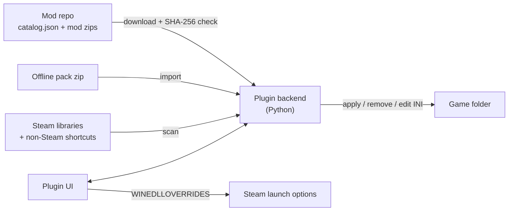

# AnyAspectRatio for Decky

Play your games in full screen at any aspect ratio (48:9 / 32:9 / 21:9 / 16:10 / 4:3 / 3:2 etc.) on Steam Deck & SteamOS.

This Decky Loader plugin finds supported games, applies aspect-ratio fixes, and helps set Steam launch options.

| Apply a fix per game                         | Edit its settings                              |
| -------------------------------------------- | ---------------------------------------------- |
|       |  |

This repository is the Decky Plugin Store build. The mods, their C++ source and the mod catalog live in [SteamAnyAspectRatioMods](https://github.com/TLin-Y/SteamAnyAspectRatioMods), where the plugin is developed.

## How it works

## Install

Install **AnyAspectRatio** from the Decky Plugin Store, then open it in the Decky menu and press **Scan for supported games**.

## Good to know

- Fixes by **Lyall** are shipped as-is and haven't all been tested by me. If one misbehaves, press Remove and tell me which game.
- Some fixes are for specific game versions. If a game updates, a fix may need a new release.
- Anti-cheat or online games: use fixes at your own risk.
- **Privacy:** This plugin has zero tracking or upload code. Turn on **Settings → Offline mode** to block all of its internet connections.
- Uninstalling the plugin deletes its downloaded zips and caches, but keeps applied fixes and launch options. Press **Remove** on each game first if you want them gone.

## What it does

- **100+ games supported.**
- **Made for the SteamOS.** My fixes default to **16:10 (1280x800)**, matching the SteamDeck screen.
- **Finds your games everywhere.** Scans every Steam library, including the microSD card.
- **Non-Steam games work too.** It is matched by its exe name.
- **Edit settings in the plugin.** Change resolution, aspect ratio or FOV right from **Game Mode**. Changes save automatically.
- **Offline friendly.** Import the repository zip once, or point it at a folder of your own mod zips.

## Tabs

- **Games**: scan for supported games, apply or remove fixes, edit settings, and read instructions.
- **Mods**: update the catalog, see mod credits, import an offline pack, or delete local files and caches. Deleting local files keeps your settings and applied mods.
- **Settings**: set the default resolution written into supported mod INIs when applying (select Width or Height to change it). After changing it, **Update current** is highlighted as a reminder to update the INIs of installed mods. You can also turn on offline mode. **More settings** holds the mod source, the local mod folder and **Reset to defaults**.

## Network access

The plugin only connects to `raw.githubusercontent.com`, and only for the mod source repository set in **Settings → More settings** (default: `TLin-Y/SteamAnyAspectRatioMods`): the mod catalog (`catalog.json`), mod READMEs, mod zips and loose mod files. Every downloaded zip and file is checked against its SHA-256 checksum in the catalog before anything is written to the game folder.

Mods contain Windows DLL/ASI files that run inside the game under Proton, not on SteamOS itself. The plugin only copies them into the selected game's folder and can remove them again. Source code for the mods is in the mod repository; third-party mods are credited in the plugin's **Mods** tab.

### Offline mode and privacy

Turn on **Settings → Offline mode** to prevent the plugin from connecting to the internet. Before going offline, download the offline mods zip from the [mod repository releases](https://github.com/TLin-Y/SteamAnyAspectRatioMods/releases/latest) and use **Mods → Import offline mods pack**. You can also use your own local mod archives. Offline mode applies to this plugin only, not Decky Loader or Steam.

## License

MIT, see [LICENSE](LICENSE). It also includes the BSD 3-Clause license of the Decky plugin template. Third-party notices: [THIRD_PARTY_NOTICES.md](defaults/THIRD_PARTY_NOTICES.md); bundled npm package licenses: [THIRD_PARTY_LICENSES.txt](defaults/THIRD_PARTY_LICENSES.txt).
