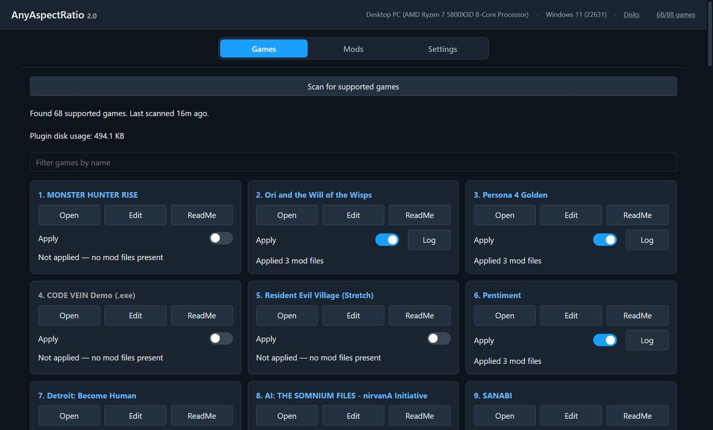
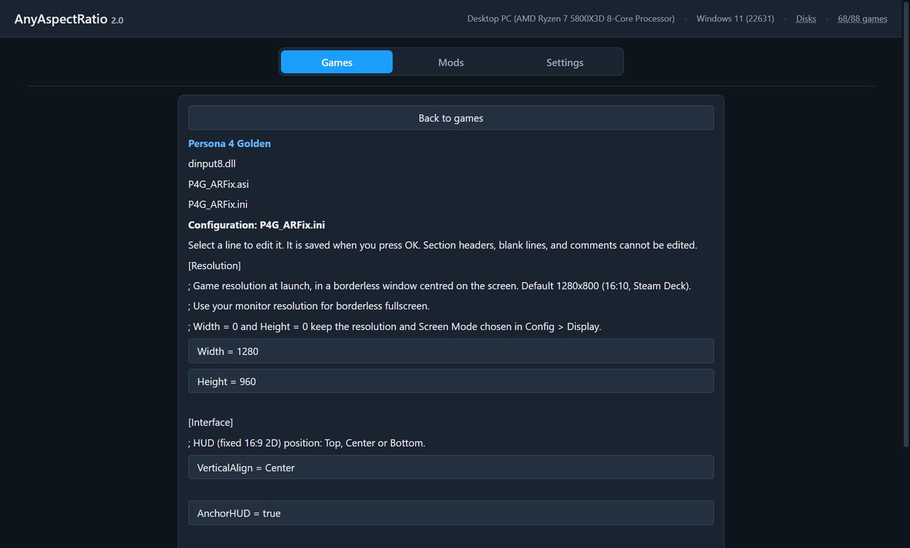

# AnyAspectRatio Desktop

Play your games in full screen at any aspect ratio (32:9 / 21:9 / 16:10 / 4:3 / 3:2 etc.) on Windows, macOS and Linux.

This desktop app finds supported games, applies aspect-ratio fixes, and sets the Wine DLL override a fix needs. It is the [AnyAspectRatio Decky plugin](../AnyAspectRatioDecky/README.md) as an app: nothing else needs to be installed.

| Apply a fix per game                              | Edit its settings                                          |
| ------------------------------------------------- | ---------------------------------------------------------- |
|       |  |

## Install

Download the file for your system from the [latest release](https://github.com/TLin-Y/SteamAnyAspectRatioMods/releases/latest):

| System | File | How to start |
|---|---|---|
| Windows 10/11 | `AnyAspectRatio-Desktop-<version>-Windows.exe` | Run it. If SmartScreen warns, choose **More info > Run anyway**. |
| macOS (Apple silicon) | `AnyAspectRatio-Desktop-<version>-macOS.zip` | Unzip and move **AnyAspectRatio** to Applications. The first time, macOS blocks it: open **System Settings > Privacy & Security** and click **Open Anyway**. |
| Linux | `AnyAspectRatio-Desktop-<version>-Linux.tar.xz` | Extract it and run `AnyAspectRatio/AnyAspectRatio`. |

Then press **Scan for supported games** and turn on **Apply** for a game.

To update, replace the app with the newer file. To remove, delete the app; its settings, cache and log stay in `%LOCALAPPDATA%\AnyAspectRatio` (Windows), `~/Library/Application Support/AnyAspectRatio` (macOS) or `~/.local/share/AnyAspectRatio` (Linux).

## Good to know

- Fixes by **Lyall** are shipped as-is and haven't all been tested by me. If one misbehaves, press Remove and tell me which game.
- Some fixes are for specific game versions. If a game updates, a fix may need a new release.
- Anti-cheat or online games: use fixes at your own risk.
- This app has zero tracking or upload code. Turn on **Settings → Offline mode** to block all of its internet connections.
- Deleting the app keeps applied fixes and Wine overrides. Press **Remove** on each game first if you want them gone.

## What it does

- **100+ games supported.**
- **Every desktop.** Windows Steam; on macOS, Windows Steam inside a CrossOver or Whisky bottle; on Linux, Steam with Proton.
- **Wine overrides handled.** Windows needs none. On macOS the app sets the override in the bottle for you (the **Wine** button shows or edits it). On Linux it shows the launch option to paste into the game's Steam properties.
- **Finds your games everywhere.** Scans every Steam library, including external drives. Games outside Steam: add their folder under **Settings → Game folders**.
- **Edit settings in the app.** Change resolution, aspect ratio or FOV. My fixes default to **16:10 (1280x800)**; **Settings → Use display** picks your screen's resolution instead.
- **Offline friendly.** Import the repository zip once, or point it at a folder of your own mod zips.

## Tabs

- **Games**: scan for supported games, apply or remove fixes, edit settings, read instructions, or open the game's folder.
- **Mods**: update the catalog, see mod credits, download or import an offline pack, or delete local files and caches. Deleting local files keeps your settings and applied mods.
- **Settings**: set the default resolution written into supported mod INIs when applying. After changing it, **Update current** is highlighted as a reminder to update the INIs of installed mods. You can also add game folders or turn on offline mode.

The header shows your computer, free disk space and how many installed games have a fix. Click **AnyAspectRatio** to open this guide.

### Offline mode and privacy

Turn on **Settings → Offline mode** to prevent the app from connecting to the internet. Before going offline, download `AnyAspectRatio-Offline-Mods-2.0.0.zip` from the release page and use **Mods → Import offline mods pack**. You can also use your own local mod archives. Offline mode applies to this app only, not Steam.

## Build

Every published release gets the three files from `.github/workflows/desktop.yml`. To build one by hand (Python 3.13 and Node 22, on the system you build for):

```
python -m pip install -r requirements.txt
python build.py
```

The result is in `build/release`. To run from source, build the page once (`cd web`, `npm ci`, `node build.mjs`), then `python app.py`. Tests: `python -m unittest discover -s test`.

## License

MIT, see [LICENSE](../LICENSE). Third-party notices: [THIRD_PARTY_NOTICES.md](../AnyAspectRatioDecky/THIRD_PARTY_NOTICES.md). The app includes Python and other open-source packages (on Linux, Qt under LGPL-3.0 through PySide6); their license texts are in `THIRD_PARTY_LICENSES.txt` inside the app and in the `-licenses.txt` file beside each download.
