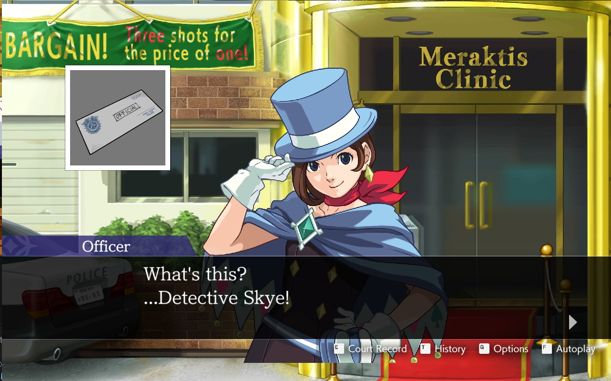
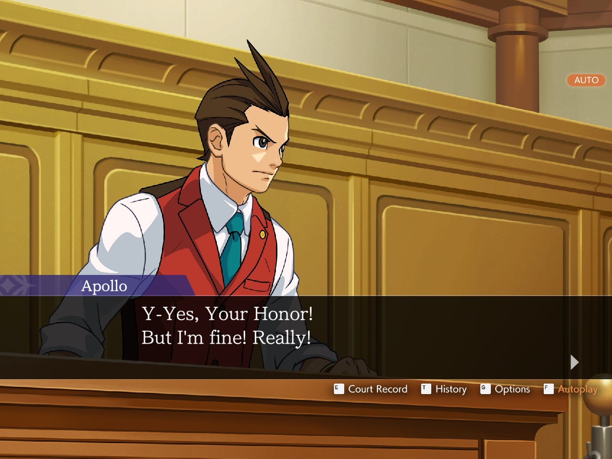

# APOLLO-JUSTICE-ACE-ATTORNEY-TRILOGY-Any-Aspect-Ratio

## 1. Install

Extract the ZIP into the game folder, beside `GS456.exe`.

## 2. Optional: SteamOS / Proton / Winlator / macOS

Launch option: `WINEDLLOVERRIDES="dinput8=n,b" %command%`

## 3. Custom Aspect Ratio

Edit `Width` and `Height` in `[Window]` in `GS456_ARFix.ini`. The default is
1280x800 (16:10). The game runs in a borderless window of that size.

The fix starts about 15 seconds after launch. It only changes the game's
display settings in memory and never modifies game code, so the game's
integrity check stays happy.

Narrower than 16:9 (16:10, 4:3): the scene fills the screen using the game's
full 3:2 background art, while the text box and HUD keep their 16:9 layout.

Wider than 16:9: the game's art is 16:9 only, so the picture stays 16:9 with
black at the sides. This is expected and not a mod bug.
