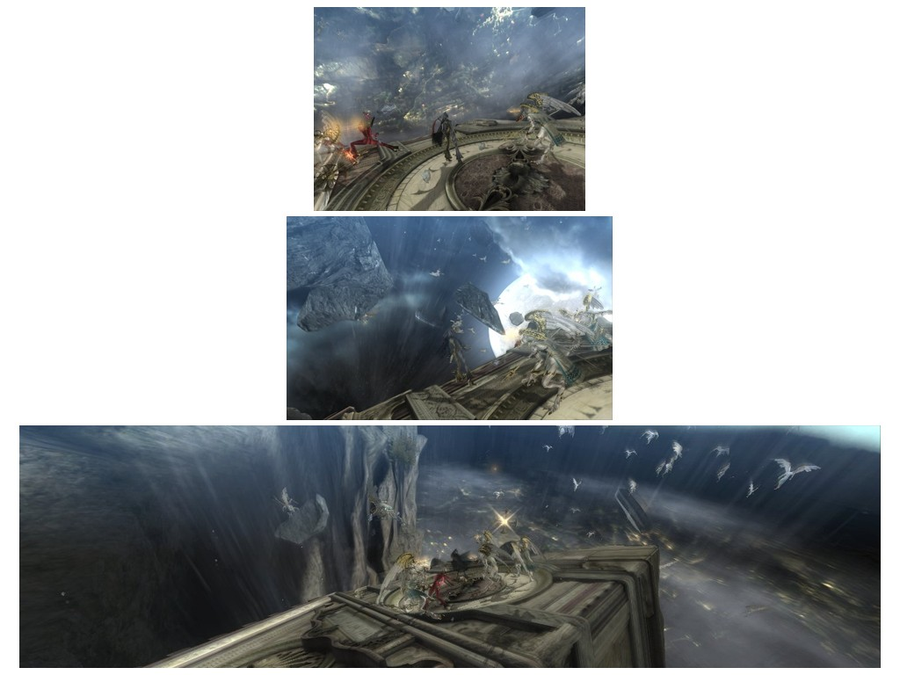

# BAYONETTA-Any-Aspect-Ratio

## 1. Install

Extract the ZIP into the game folder, beside `Bayonetta.exe`. `Bayonetta.exe` itself is
not modified, and the `aspect unlock` registry files are not needed.

## 2. SteamOS / Winlator

Launch option: `WINEDLLOVERRIDES="dinput8=n,b" %command%`

## 3. Custom Aspect Ratio

Edit `Width` and `Height` in `[Resolution]` in `Bayonetta_ARFix.ini`. The default is
1280x800 (16:10). `0` uses the resolution picked in the game options.

The game fills the screen with no black bars. Menus, the HUD and movies keep their
16:9 shape in the middle of the screen.

If the resolution has a different shape than your screen (for example 32:9 on a
16:10 Steam Deck), set **Display Mode** to **Windowed** in the game's Display
Settings. Fullscreen is switched to a borderless window automatically.

## 4. FOV

The view keeps the 16:9 horizontal FOV on any screen: wider screens show more at the
sides, taller ones (16:10, 4:3) show more above and below. To change it, edit
`Multiplier` in `[FOV]` in `Bayonetta_ARFix.ini` (`1.1` = 110%, `0.9` = 90%, range
0.5 to 2.0).
