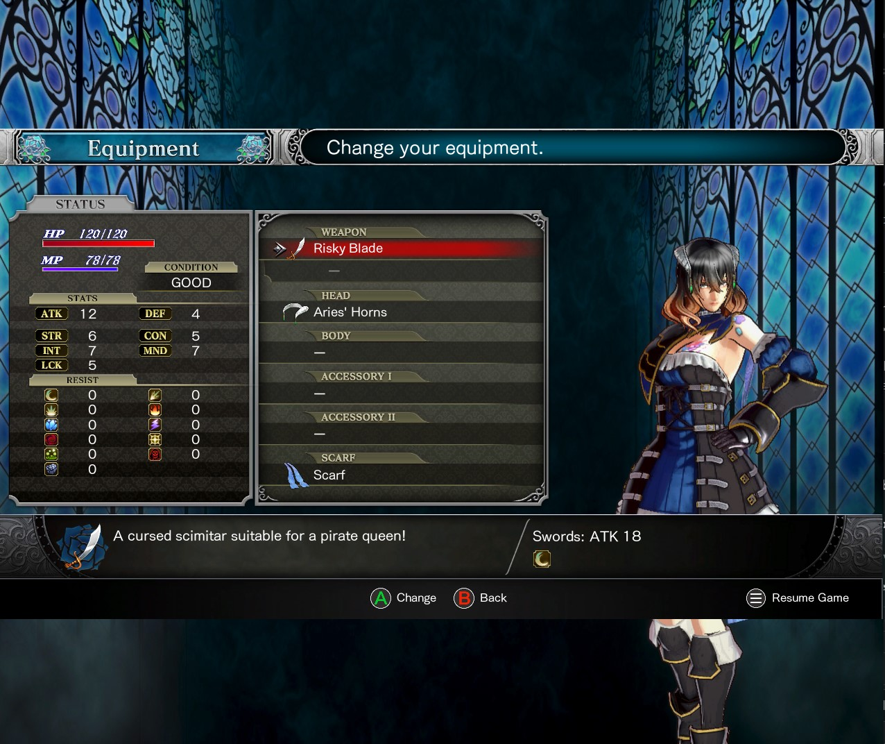
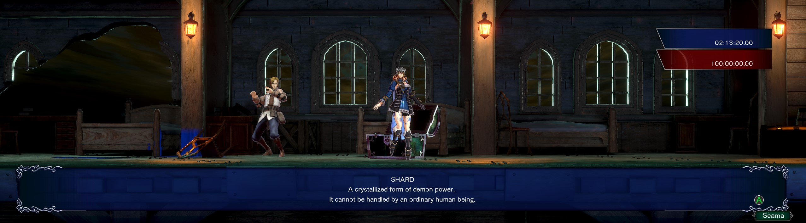

# Bloodstained: Ritual of the Night-Any-Aspect-Ratio

## Install

Extract `BloodstainedARFix.asi`,
`BloodstainedARFix.ini`, and the Ultimate ASI Loader `winmm.dll` beside
`BloodstainedRotN-Win64-Shipping.exe` in `BloodstainedRotN\Binaries\Win64`.
Use the game's windowed mode.

The root `BloodstainedRotN.exe` is the launcher; install the files beside the shipping executable, not beside the launcher.

## SteamOS / Winlator

Add the launch option:

```text
WINEDLLOVERRIDES="winmm=n,b" %command%
```

The mod uses the Microsoft Visual C++ x64 runtime. Wine environments
must have the corresponding runtime available.

## Custom Aspect Ratio

Edit `BloodstainedARFix.ini` and restart the game:

```ini
[Resolution]
Width = 1280
Height = 800

[Camera]
FOVPercent = 100
```

Default resolution is 1280x800 (16:10). `FOVPercent = 100` retains the original 16:9 horizontal FOV; use 25-200 to adjust it. Width must be 320-16384 and Height 240-16384. Both must be whole numbers.

## Demos




