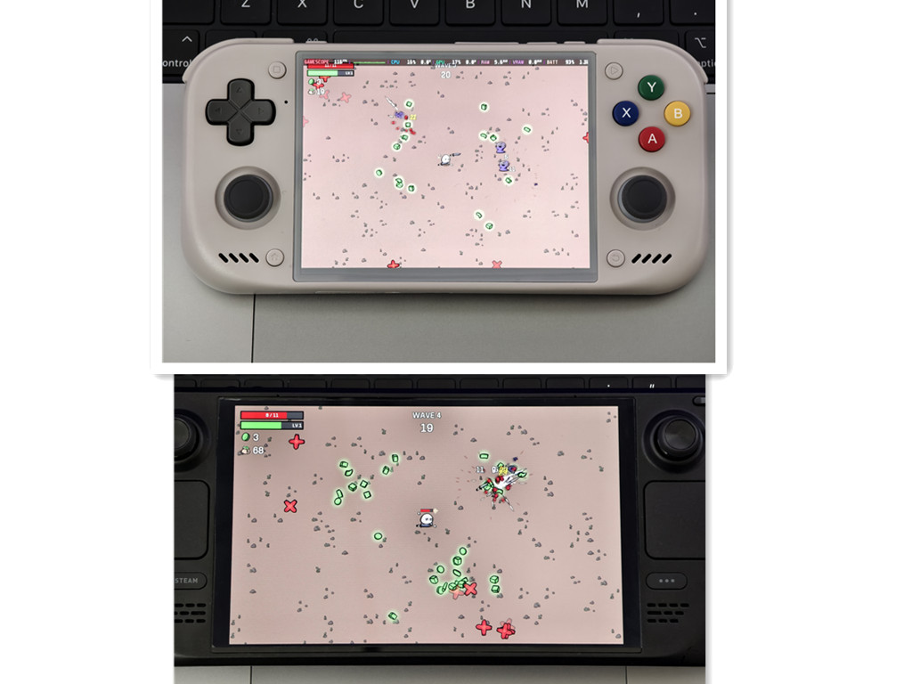

# Brotato-Any-Aspect-Ratio

Aspect-ratio fix v1.0.0 for Brotato (game version 1.2.0.3). Runs fill any screen shape (16:10 Steam Deck, 21:9, 32:9, 4:3) without stretching.

## Demo

## What changes

- Waves and the end-of-run screen fill the screen. The camera, HUD and arena backdrop follow the screen size.
- The shop fills screens taller than 16:9 (16:10, 4:3). On wider screens it stays 16:9, because its layout does not grow past 1920 pixels wide.
- The title screen and the character, weapon and difficulty selection screens keep their 16:9 layout with black bars.

## Install

1. Extract `Brotato-v1.0.0.zip` into the game folder containing `Brotato.exe`.
2. No launch option is needed on SteamOS / Proton or Winlator: the game loads the fix itself through `override.cfg` (no DLL override).

## Custom Aspect Ratio

There is no INI. The fix follows the game window: in fullscreen it matches your display, in windowed mode any window size works.

## Uninstall

Delete `override.cfg` and `AnyAspectRatio.gd` from the game folder.
