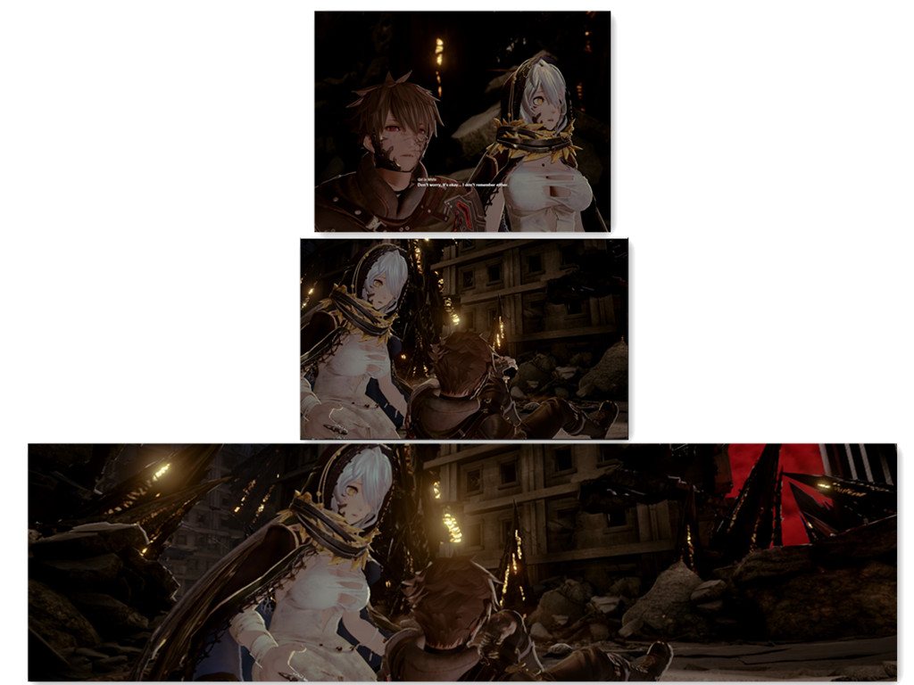

# CODE VEIN-Any-Aspect-Ratio

[](https://github.com/TLin-Y/SteamAnyAspectRatioMods) [](https://ko-fi.com/lin66961)

Runs the game at any aspect ratio without black bars, with an optional FOV multiplier and borderless window.

## Install

Extract `CodeVein_ARFix.asi`, `CodeVein_ARFix.ini`, and `winhttp.dll` into `CodeVein\Binaries\Win64`
(beside `CodeVein-Win64-Shipping.exe`). Pick your screen resolution in the game's Graphics Settings.

## SteamOS / Winlator

Add the launch option:

```text
WINEDLLOVERRIDES="winhttp=n,b" %command%
```

## Settings

Edit `CodeVein_ARFix.ini` and restart the game:

```ini
[FOV]
Multiplier = 1.0

[Display]
Borderless = false
```

`Multiplier` scales the camera field of view (0.5 to 2.0), cutscenes included.
`Borderless = true` removes the title bar in windowed mode and centres the window.

## Demo


