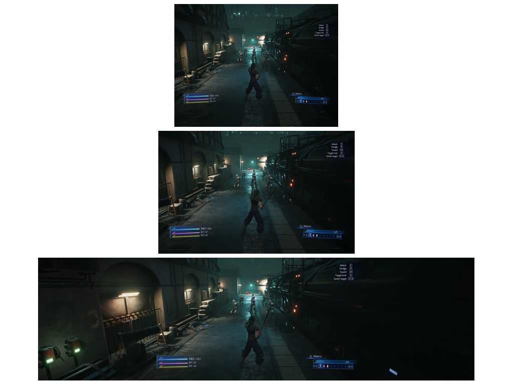

# CRISIS CORE FINAL FANTASY VII REUNION-Any-Aspect-Ratio



Runs the game at any aspect ratio without black bars, in gameplay and cutscenes, with an optional FOV multiplier.

## Install

Extract `CCFF7R_ARFix.asi`, `CCFF7R_ARFix.ini`, and `dxgi.dll` into `CCFF7R\CCFF7R\Binaries\Win64`
(beside `CCFF7R-Win64-Shipping.exe`).

## SteamOS / Winlator

Add the launch option:

```text
WINEDLLOVERRIDES="dxgi=n,b" %command%
```

## Settings

Edit `CCFF7R_ARFix.ini` and restart the game:

```ini
[Resolution]
Width = 0
Height = 0

[FOV]
Multiplier = 1.0
```

`Width` and `Height` set the resolution. `0` uses your screen resolution (borderless fullscreen). Any other size, for example `1280` and `800`, runs the game in a borderless window of that size.
`Multiplier` scales the camera field of view (0.5 to 2.0), cutscenes included.

## Known issues

- The title screen artwork stays 16:9.
