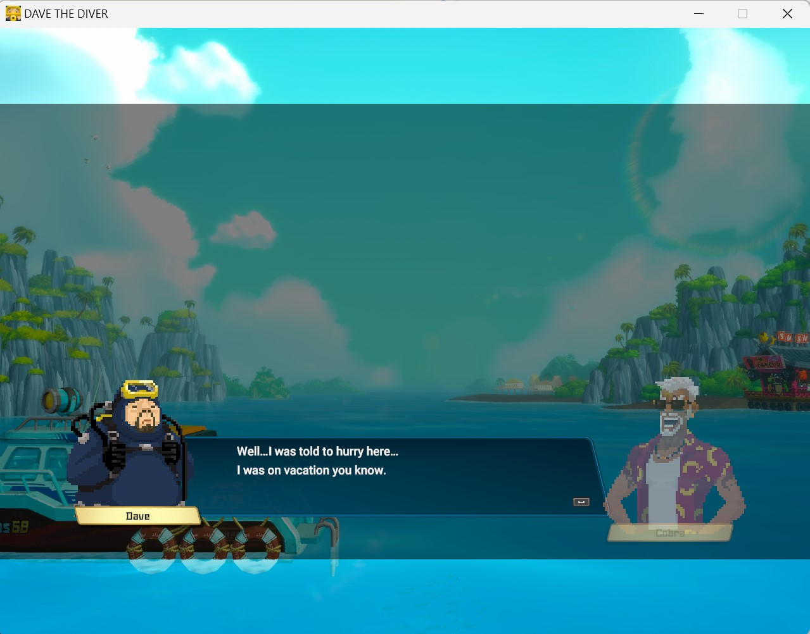
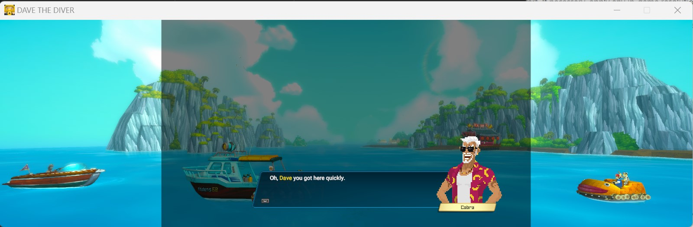

# DAVE THE DIVER-Any-Aspect-Ratio

The fix unlocks the game camera viewport for different aspect ratios.

## Demo





## Install

1. Extract the archive into the game folder containing `DaveTheDiver.exe`.
2. On SteamOS / Proton, set the Steam launch option to:
   `WINEDLLOVERRIDES="winmm=n,b" %command%`
3. On Winlator, add the environment variable `WINEDLLOVERRIDES` with value `winmm=n,b`.

## Custom Aspect Ratio

Edit `Dave_ARFix.ini` to set the desired `Width` and `Height`. The default is 1280x800 (16:10); positive values request a windowed resolution. Set both values to `0` to keep the game's resolution and fullscreen settings while using the viewport fix.

```ini
[AspectRatio]
Enabled = true

[Resolution]
Width = 1280
Height = 800
```

The fix locates its hooks by instruction pattern, so it keeps working across game updates that leave that code unchanged. Check `Dave_ARFix.log` if the fix does not load.
