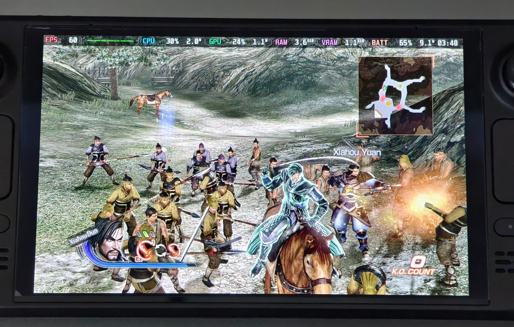

# DYNASTY-WARRIORS-7-Xtreme-Legends-Definitive-Edition-Any-Aspect-Ratio

# Set the in-game resolution to 1280x720 and the SteamOS display scaling to "Stretch" so the picture fills the screen (larger text on handhelds)

# Demo

# Install
Extract the mod files directly into your Steam game folder (where SM6EN.exe is located).

# For SteamOS / Winlator (Wine Users)
For Steam Deck / SteamOS, open the game's Properties, then General > Launch Options, and use:
`WINEDLLOVERRIDES="dinput8=n,b" %command%`

For Winlator / Wine, add this environment variable to the game or container settings:
Name: WINEDLLOVERRIDES
Value: dinput8=n,b

# Custom Aspect Ratio
Open DW7XL_ARFix.ini with any text editor. You can easily change Width and Height to match any screen ratio you want (e.g., 4:3, 16:10, 21:9). The mod defaults to 1280x800 (16:10).
