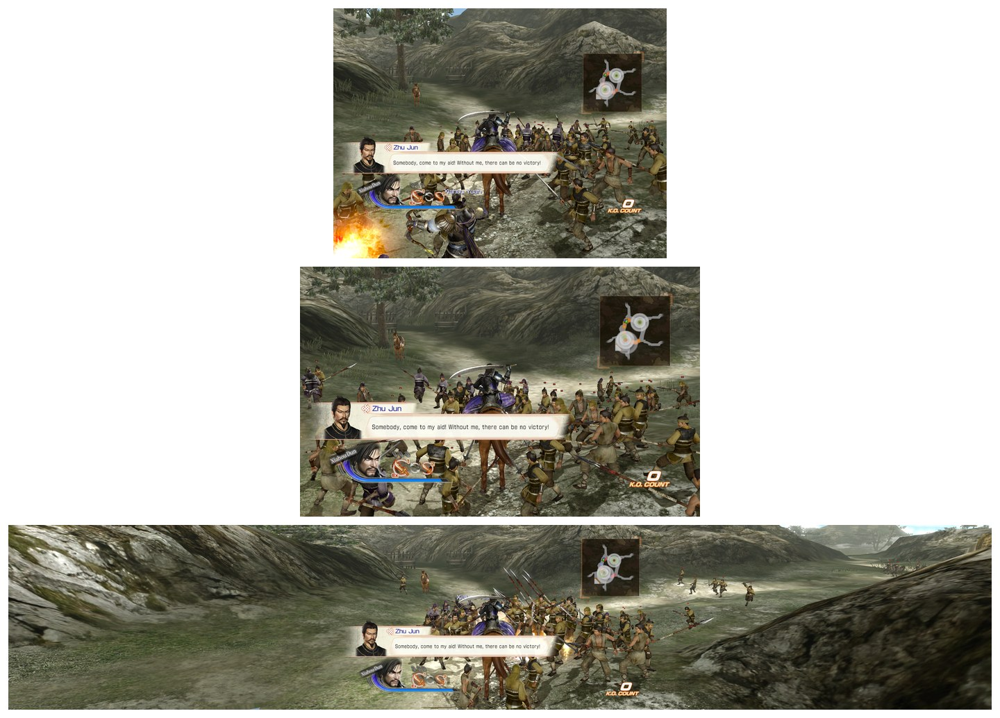

# DYNASTY-WARRIORS-7-Xtreme-Legends-Definitive-Edition-Any-Aspect-Ratio

Set the in-game resolution to your screen resolution (Steam Deck: 1280x800 or Fullscreen). The game draws a 16:9 picture with black bars on other screens; the mod stretches that picture to fill the whole screen, so no SteamOS display scaling is needed. The old way (in-game 1280x720 with SteamOS display scaling set to "Stretch") still works. To turn the mod's stretching off, set Enabled = false under [Stretch].

# Demo

# Install
Extract the mod files directly into your Steam game folder (where SM6EN.exe is located).

# For SteamOS / Winlator (Wine Users)
For Steam Deck / SteamOS, open the game's Properties, then General > Launch Options, and use:
`WINEDLLOVERRIDES="dinput8=n,b" %command%`

For Winlator / Wine, add this environment variable to the game or container settings:
Name: WINEDLLOVERRIDES
Value: dinput8=n,b

# Custom Aspect Ratio
Open DW7XL_ARFix.ini with any text editor. You can easily change Width and Height to match any screen ratio you want (e.g., 4:3, 16:10, 21:9). The mod defaults to 1280x800 (16:10).

# macOS (CrossOver)
Use Fullscreen; the mod turns it into a borderless window that covers the whole screen. Set Width and Height in the ini to your screen size (for example 1728 and 1117 on a MacBook Pro 16").
