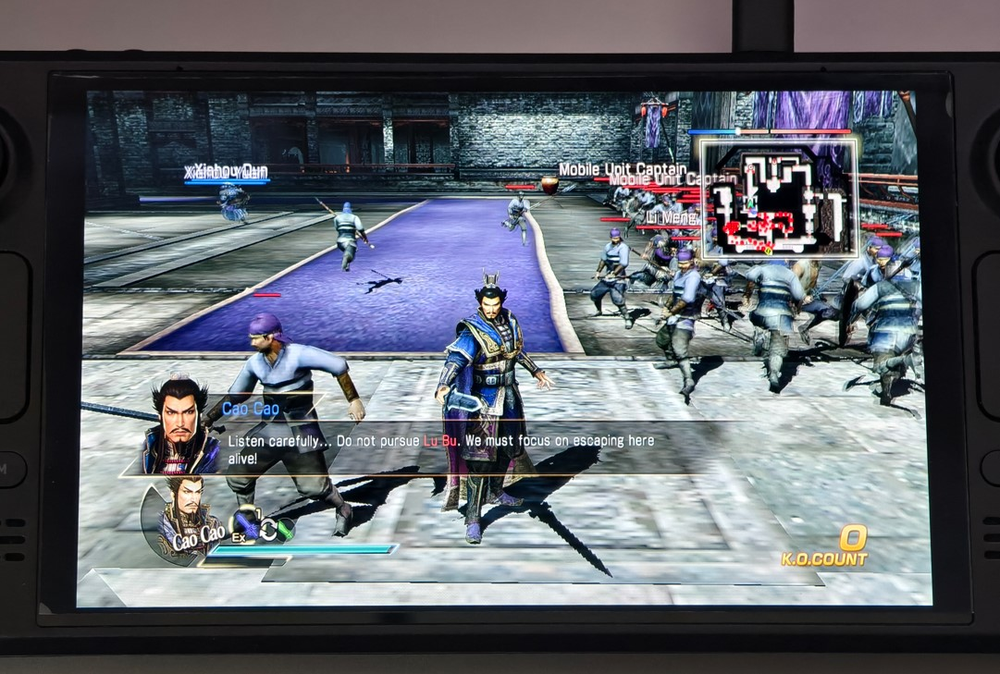

# DYNASTY-WARRIORS-8-Xtreme-Legends-Complete-Edition-Any-Aspect-Ratio

Set the in-game resolution to 1280x720 and the SteamOS display scaling to "Stretch" so the picture fills the screen.

## Demo

## Install
Extract the mod files directly into your Steam game folder (where Launch.exe is located).

## For SteamOS / Winlator (Wine Users)
For Steam Deck / SteamOS, open the game's Properties, then General > Launch Options, and use:
`WINEDLLOVERRIDES="dinput8=n,b" %command%`

For Winlator / Wine, add this environment variable to the game or container settings:
Name: WINEDLLOVERRIDES
Value: dinput8=n,b

## Custom Aspect Ratio
Open DW8XL_ARFix.ini with any text editor. Change Width and Height to match your screen ratio. The mod defaults to 1280x800 (16:10).

## Camera / FOV
In DW8XL_ARFix.ini, change FovMultiplier under [Camera] to adjust the standard and blocking camera distances. The packaged default is 1.10 (110%); use 1.0 for the game's original distances. Suggested values are 1.10 for 16:10, 1.16 for 3:2, and 1.29 for 4:3.
