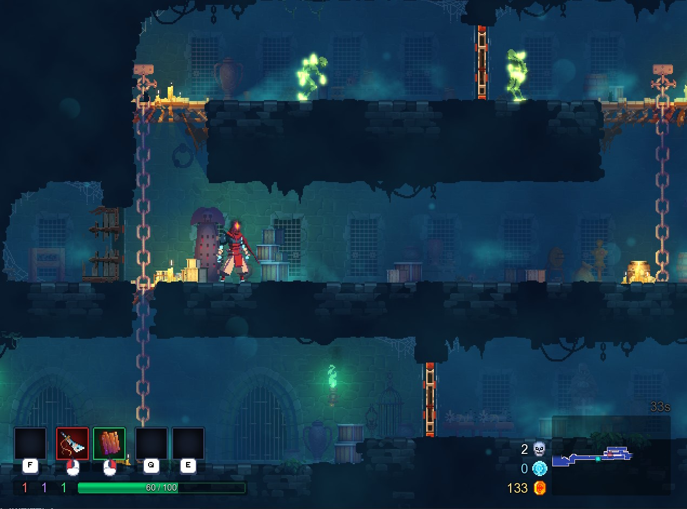
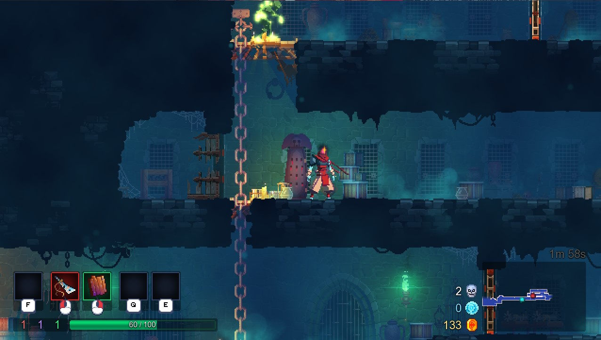
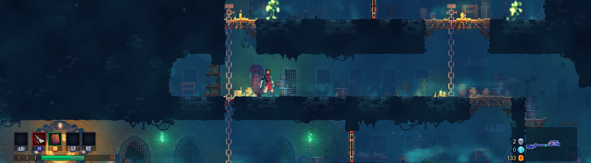

# DEAD-CELLS-Any-Aspect-Ratio

## 1. Install

Extract the ZIP into the game folder, beside `deadcells.exe`.

## 2. Optional: SteamOS / Proton / Winlator / macOS

Launch option: `WINEDLLOVERRIDES="dinput8=n,b" %command%`

## 3. Custom Aspect Ratio

Edit `Width` and `Height` in `[Window]` in `deadcells_ARFix.ini`. The default is
1280x800 (16:10). The game runs in a borderless window of that size.
`Width = 0` and `Height = 0` use the full monitor resolution.

The game fills any window shape with no black bars: wider screens show more to
the sides, taller ones (16:10, 4:3) show more above and below. The HUD stays in
the screen corners.

While `[Window] Enabled = true`, the mod controls the window and the in-game
Window Mode option has no effect. Set it to `false` to use the game's own
windowed/fullscreen modes; the picture still fills the screen.

Works with the default DirectX version (`deadcells.exe`), not the OpenGL legacy option.
