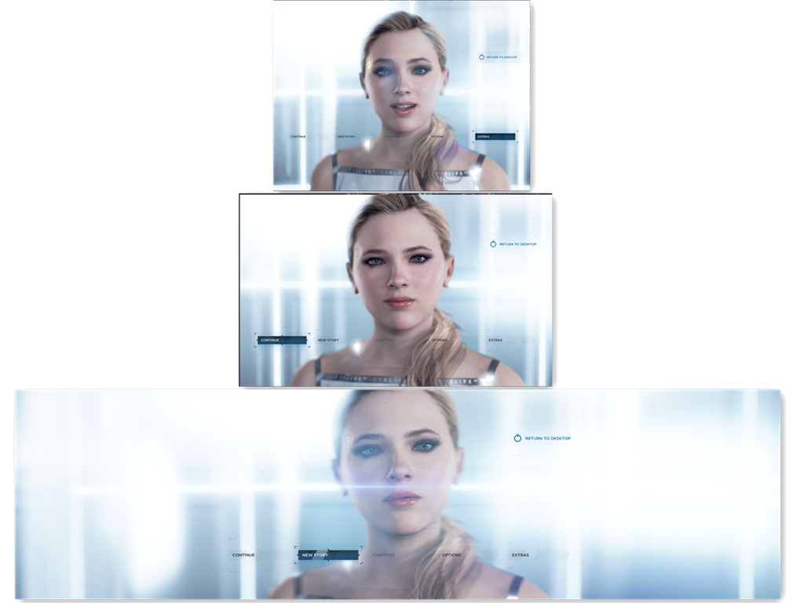

# DETROIT-BECOME-HUMAN-Any-Aspect-Ratio

## 1. Install

Extract the ZIP into the game folder, beside `DetroitBecomeHuman.exe`.

## 2. Optional: SteamOS / Proton / Winlator / macOS

Launch option: `WINEDLLOVERRIDES="dinput8=n,b" %command%`

## 3. Custom Aspect Ratio

Edit `Width` and `Height` in `[Resolution]` in `DetroitBecomeHuman_ARFix.ini`.
The default is 1280x800 (16:10, Steam Deck). Use your screen resolution.

The game fills the whole screen with no black bars. On screens narrower than 16:9
you see the full 16:9 width plus more at the top and bottom. On ultrawide screens
the HUD stays 16:9 in the middle of the screen.

`Borderless = true` starts the game in a borderless window of `Width` x `Height`.
`Width = 0` and `Height = 0` use the game's own borderless mode (whole monitor).
`FOV` in `[Camera]` changes the field of view (default 1.0).

If the picture looks blurry, raise the in-game Resolution to match `Width` x `Height`.
