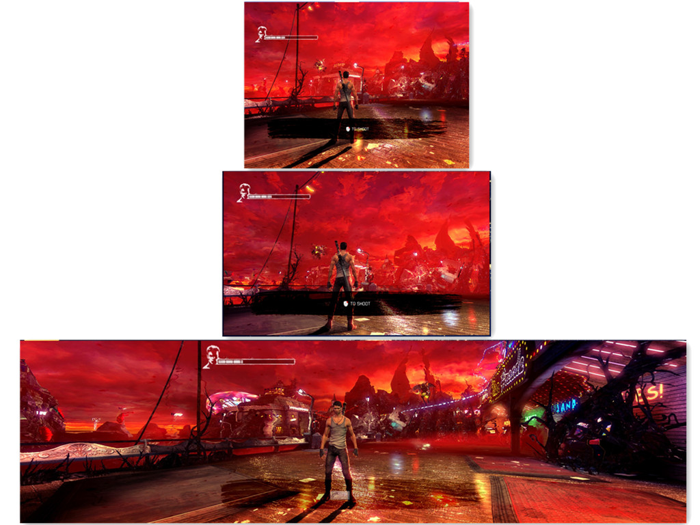

# DMC-DEVIL-MAY-CRY-Any-Aspect-Ratio

 

## 1. Install

Extract the ZIP into `Binaries\Win32` in the game folder, beside `DMC-DevilMayCry.exe`.

## 2. Optional: SteamOS / Proton / Winlator / macOS

Launch option: `WINEDLLOVERRIDES="dinput8=n,b" %command%`

## 3. Custom Aspect Ratio

Set the game's display mode to **Windowed** (required). In fullscreen the game does not start with this fix.

Edit `Width` and `Height` in `[Resolution]` in `DMC-DevilMayCry_ARFix.ini`.
The default is 1280x800 (16:10, Steam Deck). Use your screen resolution.
`Width = 0` and `Height = 0` use the resolution selected in the game.

The game fills the whole screen with no black bars. The HUD and menus stay 16:9
in the middle of the screen. Movies play in 16:9.

`Borderless = true` removes the window frame in windowed mode.
`FOV` in `[Camera]` changes the field of view (default 1.0).
