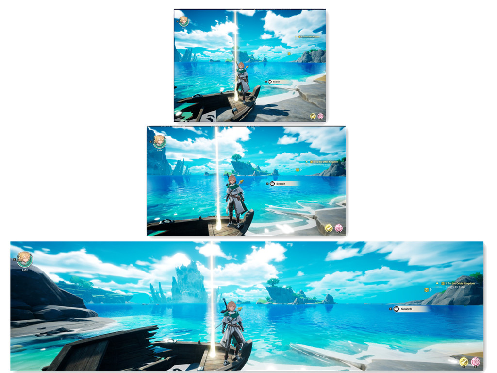

# DragonSword: Awakening-Any-Aspect-Ratio

Removes the black bars from cutscenes and runs the game at any aspect ratio.

## Install

Extract `DSClient_ARFix.asi`, `DSClient_ARFix.ini`, and `winmm.dll` into `DS\Binaries\Win64`
(beside `DSClient-Win64-Shipping.exe`). Use the game's windowed mode.

## SteamOS / Winlator

Add the launch option:

```text
WINEDLLOVERRIDES="winmm=n,b" %command%
```

## Custom Aspect Ratio

Edit `DSClient_ARFix.ini` and restart the game:

```ini
[Resolution]
Width = 1280
Height = 800

[FOV]
KeepHorizontalFOV = 1
```

Default is 1280x800 (16:10). On screens narrower than 16:9, `KeepHorizontalFOV = 1` shows more above and below; `0` crops the sides instead.

## Demo


