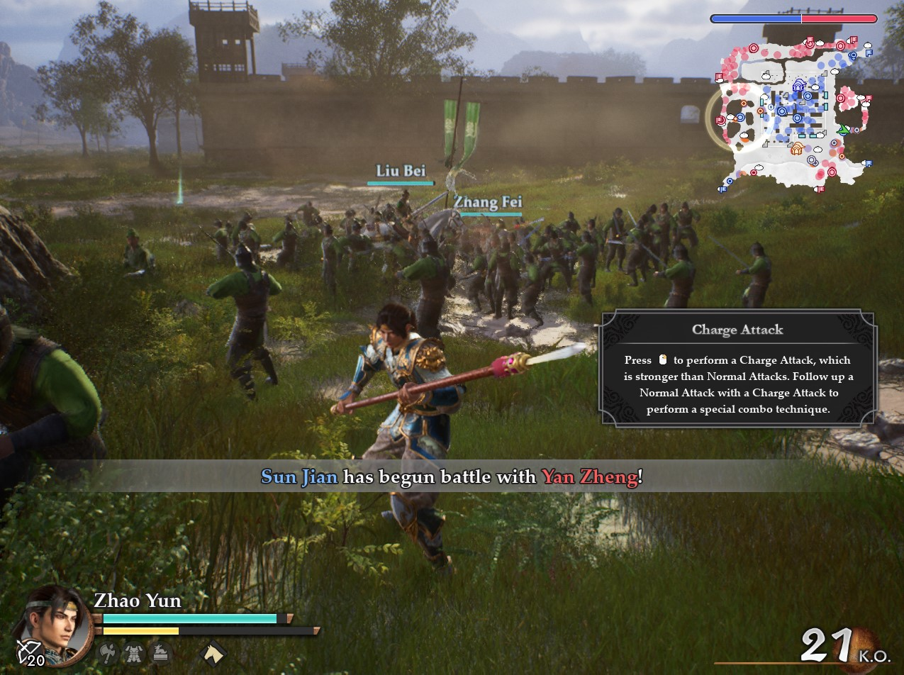
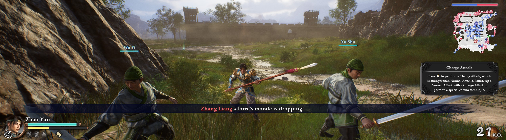

# Dynasty Warriors 3: Remastered - Custom Resolution

The game already supports ultrawide and 16:10. This mod is for custom borderless-window resolutions, especially narrow displays such as 1:1, 3:2, and 4:3.

## 1. Install

Extract the ZIP into the game folder, next to the game executable.

## 2. Choose a resolution

Edit `DW3RE_ARFix.ini`. Set `Width` and `Height` to the resolution you want. The included settings use `2560x720` as an example; change them to match your display. The mod creates a borderless window at these dimensions.





## 3. Steam Deck / Proton

In the game's **Properties > General > Launch Options**, enter:

```text
WINEDLLOVERRIDES="dxgi=n,b" %command%
```

Windows does not need a launch option.
