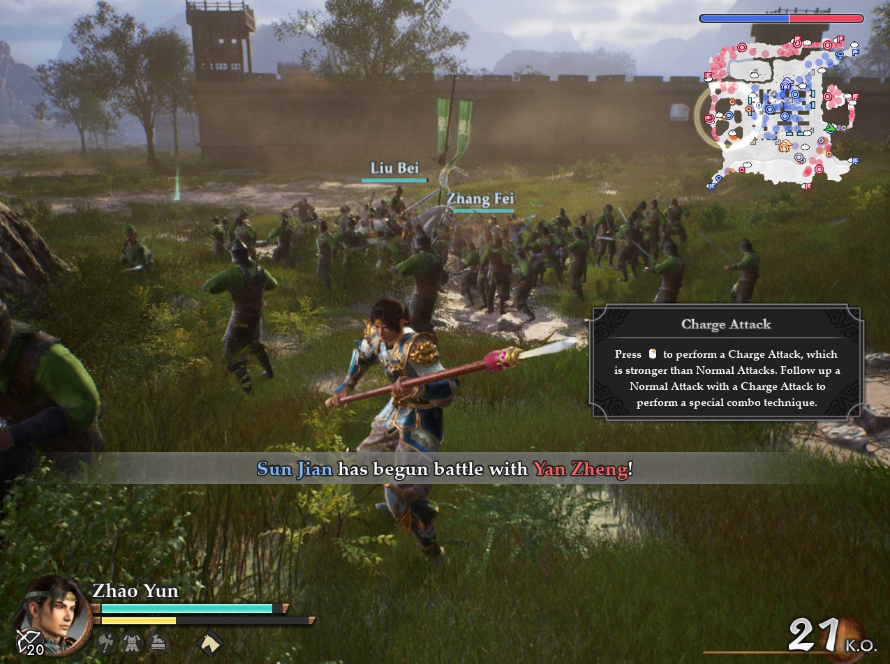
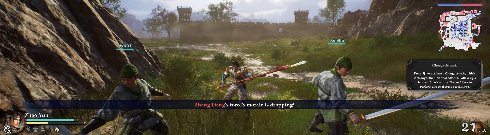

# Dynasty Warriors 3: Remastered - Custom Resolution and FOV

[](https://github.com/TLin-Y/SteamAnyAspectRatioMods) [](https://ko-fi.com/lin66961)

The game already supports ultrawide and 16:10. This mod is for custom borderless-window resolutions, especially narrow displays such as 1:1, 3:2, and 4:3.

## 1. Install

Extract the ZIP into `DW3CE_RE\Binaries\Win64` inside the game folder, next to `DW3CE_RE-Win64-Shipping.exe`.

## 2. Choose a resolution

Edit `DW3RE_ARFix.ini`. Set `Width` and `Height` to the resolution you want. The included settings use `1280x800` (Steam Deck); change them to match your display. The mod creates a borderless window at these dimensions.





## 3. Field of view

In the same INI, `[FOV] Multiplier` sets the camera field of view. `1.0` is the game default and keeps the 16:9 horizontal view on narrower screens such as 4:3. `1.1` = 110%, `1.2` = 120%, and so on (range 0.5-2.0).

## 4. Steam Deck / Proton

In the game's **Properties > General > Launch Options**, enter:

```text
WINEDLLOVERRIDES="dxgi=n,b" %command%
```

Windows does not need a launch option.
