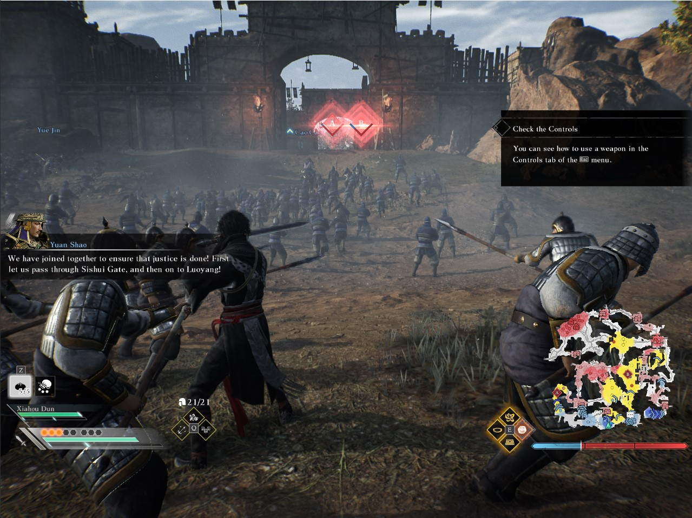
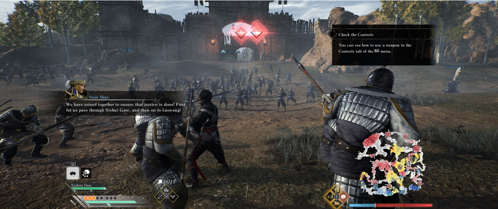

# Dynasty Warriors: Origins - Any Aspect Ratio

[](https://github.com/TLin-Y/SteamAnyAspectRatioMods) [](https://ko-fi.com/lin66961)

## 1. Install

Extract the ZIP into the game folder, next to the game executable.

## 2. Choose your resolution

Edit `DWOriginsFix.ini`. `Width` and `Height` are the resolution to use; the default `1280x800` is for Steam Deck. For example, use `1280x960` for 4:3, or set these values to your display resolution for 21:9 and wider screens.

`TargetWidth` and `TargetHeight` are the built-in game resolution to replace, not the output resolution. Leave the default `3840x2160` for the 16:9 game mode. For the built-in 21:9 mode, use `3840x1600`.





In the game's graphics options, select the top resolution entry (the replaced `3840x2160`). It now shows your custom resolution.

## 3. Field of view

`FOVScale` in the `[FOV]` section of `DWOriginsFix.ini`:

- `0` (default): automatic. On screens narrower than 16:9 (16:10, 4:3), the field of view is widened so you see as much to the sides as at 16:9. 16:9 and wider screens are unchanged.
- `0.5` to `2.0`: multiply the game's field of view by this value, for example `1.2` for 20% wider.
- Any other value turns the FOV change off.

Only the main 3D camera is changed; the HUD keeps its layout.

## 4. Steam Deck launch option

In the game's **Properties > General > Launch Options**, enter:

```text
WINEDLLOVERRIDES="dinput8=n,b" %command%
```

Windows does not need a launch option.
