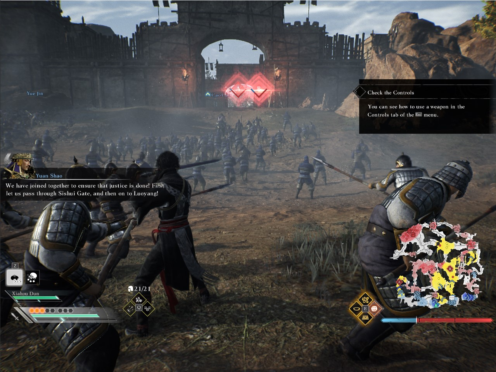
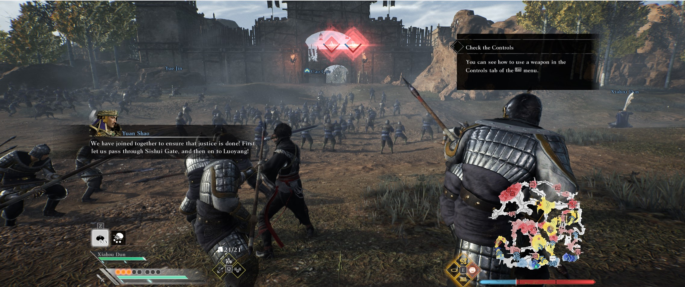

# Dynasty Warriors: Origins - Any Aspect Ratio

## 1. Install

Extract the ZIP into the game folder, next to the game executable.

## 2. Choose your resolution

Edit `DWOriginsFix.ini`. `Width` and `Height` are the resolution to use; the default `1280x800` is for Steam Deck. For example, use `1280x960` for 4:3, or set these values to your display resolution for 21:9 and wider screens.

`TargetWidth` and `TargetHeight` are the built-in game resolution to replace, not the output resolution. Leave the default `3840x2160` for the 16:9 game mode. For the built-in 21:9 mode, use `3840x1600`.





## 3. Steam Deck launch option

In the game's **Properties > General > Launch Options**, enter:

```text
WINEDLLOVERRIDES="dinput8=n,b" %command%
```

Windows does not need a launch option.
