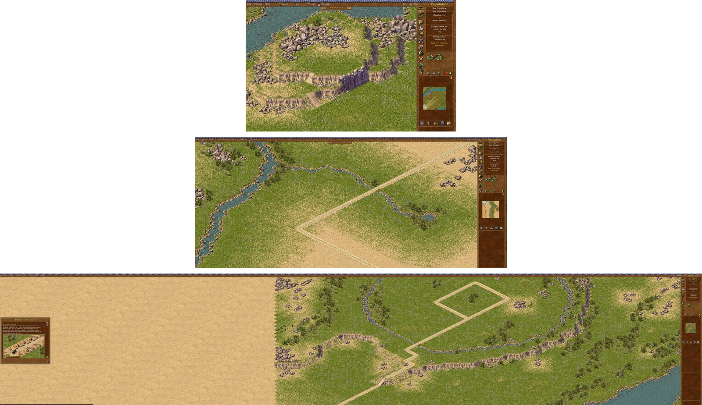

# EMPEROR-RISE-OF-THE-MIDDLE-KINGDOM-Any-Aspect-Ratio

 

For the GOG version (`Emperor.exe` v1.0.1.0). The game is not sold on Steam; on
SteamOS add `Emperor.exe` as a non-Steam game.

## 1. Install

Extract the ZIP into the game folder, beside `Emperor.exe`. No loader DLL is
needed: the game's sound system loads `Emperor_ARFix.asi` by itself. No game file
is changed; delete the two files to remove the mod.

## 2. Optional: SteamOS / Proton / Winlator / macOS

No launch option needed.

## 3. Custom Resolution

Edit `Width` and `Height` in `[Window]` in `Emperor_ARFix.ini`. The default is
1280x800 (16:10, Steam Deck). Use your screen resolution. `Width = 0` and
`Height = 0` use the primary monitor resolution. Minimum 1024x768.
