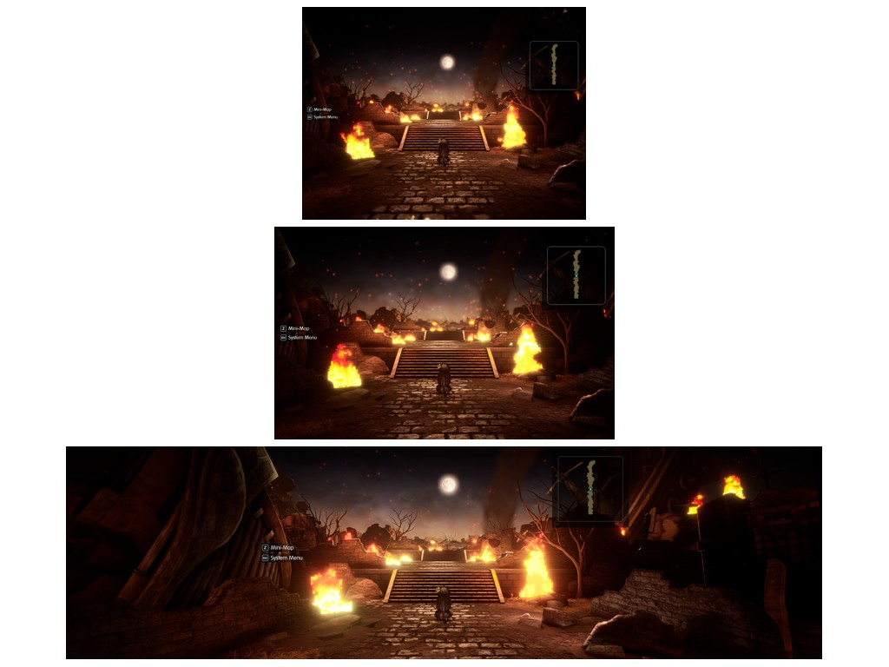

# FINAL FANTASY RESONANCE-Any-Aspect-Ratio

[](https://github.com/TLin-Y/SteamAnyAspectRatioMods) [](https://ko-fi.com/lin66961)



Runs the game at any aspect ratio without black bars. Narrower screens keep the 16:9 side view and show more above and below; wider screens show more at the sides. The HUD can sit at the screen edges or in the 16:9 area, and movies always stay 16:9. Works with the full game and the demo.

## Install

Extract `FFRS_ARFix.asi`, `FFRS_ARFix.ini`, and `winmm.dll` into `FFRS\Binaries\Win64` inside the game folder
(beside `FFRS-Win64-Shipping.exe`).

## SteamOS / Winlator

Add the launch option:

```text
WINEDLLOVERRIDES="winmm=n,b" %command%
```

## Settings

Edit `FFRS_ARFix.ini` and restart the game:

```ini
[Resolution]
Width = 1280
Height = 800

[FOV]
Multiplier = 1.0

[HUD]
Layout = Edges
Scale = 1.0
```

`Width` and `Height` set the resolution and aspect ratio (default 1280x800, 16:10) in a window of that size. Set both to `0` to use your screen resolution (borderless fullscreen).
The in-game resolution and window settings are overridden by the mod.
`Multiplier` scales the camera field of view (0.5 to 2.0).
`Layout = Edges` puts the HUD at the screen edges; `Layout = Centered` keeps the HUD and menus in the 16:9 area like the original game.
`Scale` changes the size of text and UI (0.5 to 2.0), for example `1.2` on a 4:3 screen.
