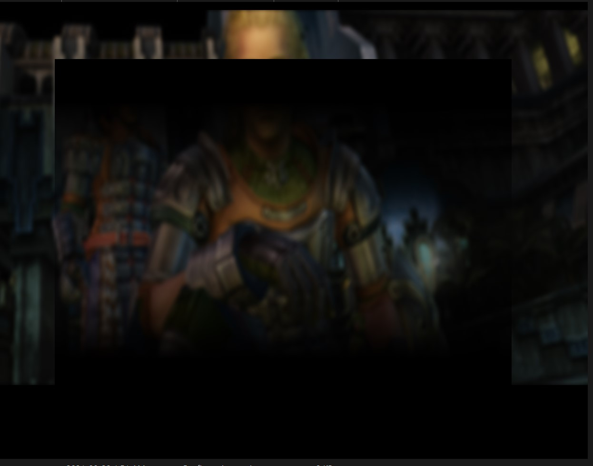
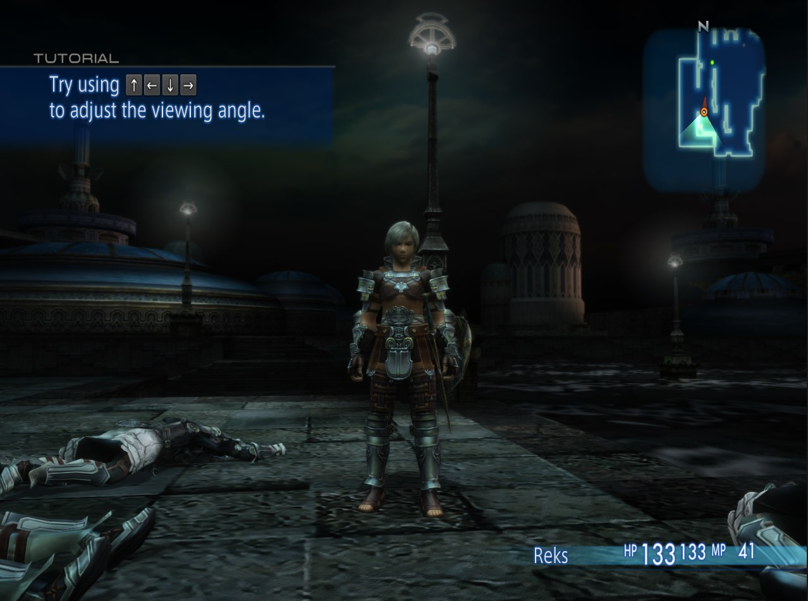
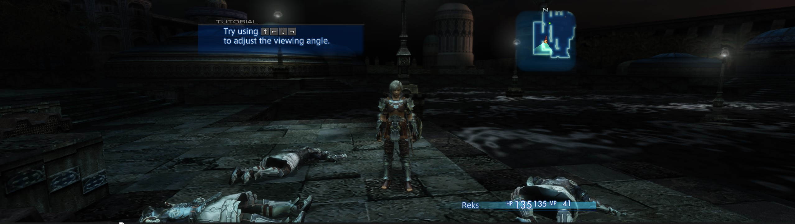

# FINAL-FANTASY-XII-THE-ZODIAC-AGE-Any-Aspect-Ratio

## Install

Extract the ZIP into the game's `x64` folder, beside `FFXII_TZA.exe`. Set the
game's screen mode to **Windowed**, then launch the game.

## SteamOS / Winlator

Launch option: `WINEDLLOVERRIDES="dinput8=n,b" %command%`

## Custom Aspect Ratio

Edit `Width` and `Height` in `[Window]` in `FFXII_TZA_ARFix.ini`. Resolution
and FOV fixes are enabled by default.

Narrower screens preserve horizontal coverage; ultrawide screens preserve
vertical coverage. Legacy effect layers and menu backgrounds use matching
projection framing, fixing ghosting and compressed pause-menu backgrounds.
Set `Borderless = false` to keep window borders.

The fix uses code signatures instead of an executable version check. Other
versions may work, but have not been tested; missing hooks are logged.
