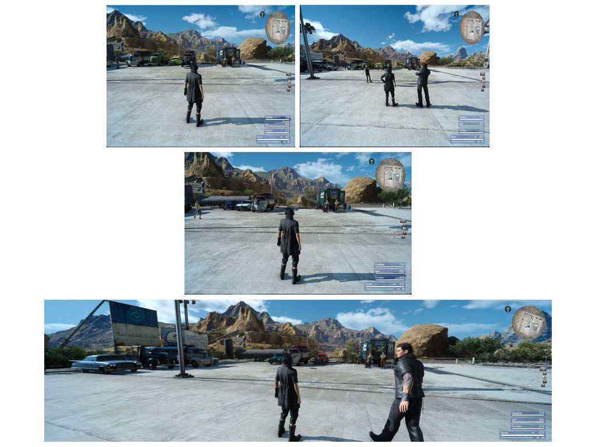

# FINAL FANTASY XV WINDOWS EDITION-Any-Aspect-Ratio



Removes the black bars at aspect ratios narrower than 16:9 (16:10, 4:3) and keeps the 16:9 field of view in third-person gameplay, with an adjustable FOV multiplier.
The game already supports ultrawide screens natively; there the mod only applies the FOV multiplier.

## Install

Extract `dinput8.dll`, `FFXV_ARFix.asi`, and `FFXV_ARFix.ini` into the game folder (beside `ffxv_s.exe`).
Pick your resolution in the game's display settings.

## SteamOS / Winlator

Add the launch option:

```text
WINEDLLOVERRIDES="dinput8=n,b" %command%
```

## Settings

Edit `FFXV_ARFix.ini` and restart the game:

```ini
[FOV]
Multiplier = 1.0
```

`Multiplier` scales the third-person camera field of view (0.5 to 2.0).

## Known issues

- Below 16:9, menus and the HUD use the game's 16:9 layout stretched to the screen (slightly taller at 16:10).
- Cutscenes and the title screen fill the screen but keep their original framing; the FOV multiplier only affects the third-person camera.
