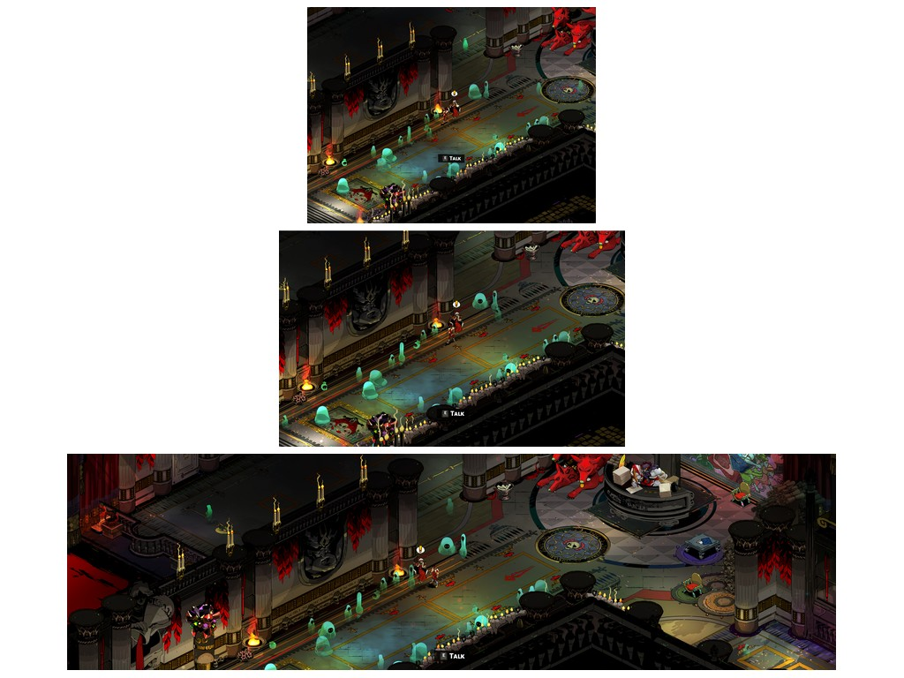

# Hades-Any-Aspect-Ratio

[](https://github.com/TLin-Y/SteamAnyAspectRatioMods) [](https://ko-fi.com/lin66961)



Runs the game at any aspect ratio without black bars or stretching. Wider screens show more at the sides; narrower screens (4:3, 16:10) show more above and below. Menus, dialogue and subtitles stay centred.

## Install

Extract the zip into the Hades game folder (the folder with `Content`, `x64` and `x64Vk`). It places the files beside both `x64/Hades.exe` (DirectX) and `x64Vk/Hades.exe` (Vulkan, used on Steam Deck).

## SteamOS / Winlator

Add the launch option:

```text
WINEDLLOVERRIDES="winmm=n,b" %command%
```

## Settings

The game uses the resolution set in the game (Options > Display).

Edit `Hades_ARFix.ini` (in `x64` or `x64Vk`, whichever you play) to choose the area the HUD is placed in:

```ini
[HUD]
Width = 0
Height = 0
```

`0` and `0` = automatic: a centred 16:9 area on screens narrower than 16:9, full screen up to 21:9, a centred 21:9 area on 32:9, and a centred 16:9 area on triple-monitor screens. Set e.g. `16` and `9` for the original layout.

## Alternative

[Hephaistos](https://github.com/nbusseneau/hephaistos) by Nicolas Busseneau (MIT) is another complete fix that patches the game files; it must be run manually.
