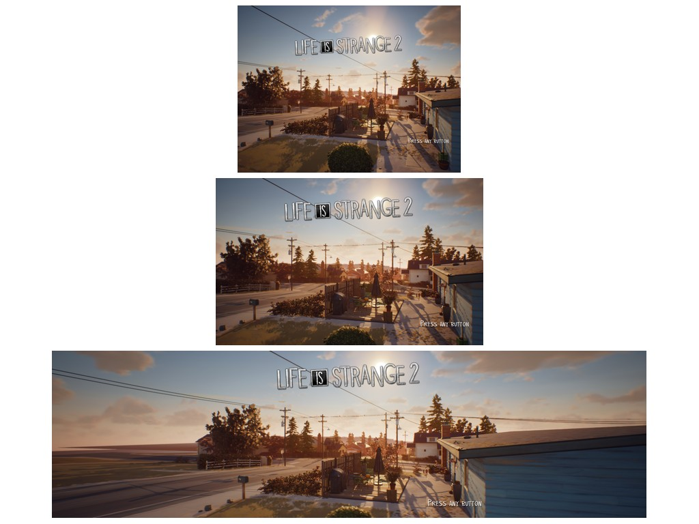

# Life is Strange 2-Any-Aspect-Ratio

[](https://github.com/TLin-Y/SteamAnyAspectRatioMods) [](https://ko-fi.com/lin66961)



Runs the game at any aspect ratio without black bars, in gameplay and cutscenes, with an optional FOV multiplier.

## Install

Extract `LIS2_ARFix.asi`, `LIS2_ARFix.ini`, and `dinput8.dll` into `Life is Strange 2\LIS2\Binaries\Win64`
(beside `LIS2-Win64-Shipping.exe`).

## SteamOS / Winlator

Add the launch option:

```text
WINEDLLOVERRIDES="dinput8=n,b" %command%
```

## Settings

Edit `LIS2_ARFix.ini` and restart the game:

```ini
[Resolution]
Width = 0
Height = 0

[FOV]
Multiplier = 1.0
```

`Width` and `Height` set the resolution. `0` uses your screen resolution (borderless fullscreen). Any other size, for example `1280` and `800`, runs the game in a borderless window of that size.
The in-game Screen Resolution and Display Mode settings are overridden by the mod.
`Multiplier` scales the camera field of view (0.5 to 2.0), cutscenes included.
