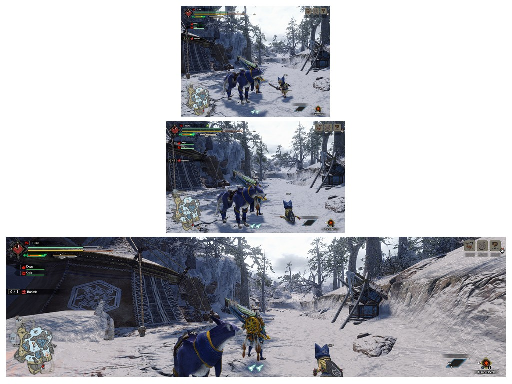

# Monster Hunter Rise-Any-Aspect-Ratio

 

Runs the game at any aspect ratio without black bars.

Why?
- REFramework currently blows up on ARM64EC containers. It crashes straight away once the x86 instrumentation gets dispatched.

1. Install

Extract the mod files directly into your Monster Hunter Rise root folder (where MonsterHunterRise.exe is located).

2. For SteamOS / Winlator (Wine Users)

For Steam Deck / SteamOS, open the game's Properties, then General > Launch Options, and use:
`WINEDLLOVERRIDES="dinput8=n,b" %command%`

For Winlator / Wine, add the following environment variable to the game or container settings:
Name: WINEDLLOVERRIDES
Value: dinput8=n,b

3. Full Screen (default, also macOS / CrossOver)

Set the in-game resolution to your screen resolution (for example 1280x800 on Steam Deck) and keep the in-game Aspect Ratio at 16:9. The game fills the whole screen; the status bar stays at the top, the minimap and item bar at the bottom, and menus are centered.

Ultrawide screens (21:9, 32:9): set the in-game Aspect Ratio to match your screen.

4. Full-Screen Stretching (old way)

Set your SteamOS display scaling to "Stretch" and set the in-game resolution to 1280x720. The picture is rendered at the ratio in the ini (TargetWidth / TargetHeight, default 16:10) and stretched to fill the screen.

To go back to this behavior only, set `Enabled = false` under `[FitScreen]` in MHRiseFix.ini.

## Demo

