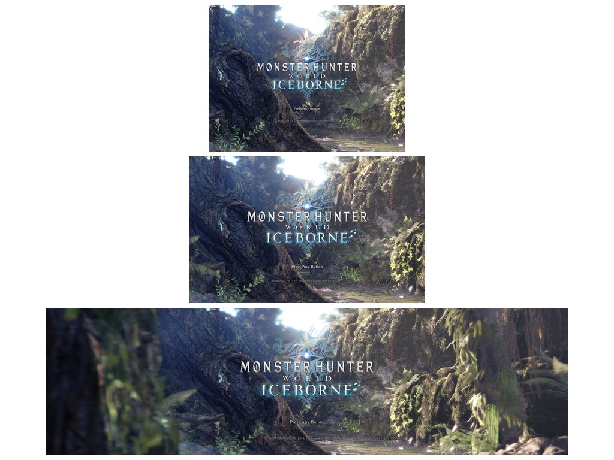

# Monster Hunter: World-Any-Aspect-Ratio

[](https://github.com/TLin-Y/SteamAnyAspectRatioMods) [](https://ko-fi.com/lin66961)



Runs the game at any aspect ratio without black bars, with DirectX 11 and DirectX 12. Narrower screens keep the 16:9 side view and show more above and below; wider screens show more at the sides.

## Install

Extract `MonsterHunterWorld_ARFix.asi`, `MonsterHunterWorld_ARFix.ini`, and `dinput8.dll` into the game folder (beside `MonsterHunterWorld.exe`).

Remove other aspect ratio fixes first (for example `mhw_16x10.ini` and its `dinput8.dll`).

## SteamOS / Winlator

Add the launch option:

```text
WINEDLLOVERRIDES="dinput8=n,b" %command%
```

## Settings

Pick your screen resolution in the game, for example 1280 x 800 on the Steam Deck.

Edit `MonsterHunterWorld_ARFix.ini` and restart the game:

```ini
[HUD]
Center16x9 = 0
```

`Center16x9 = 1` keeps the HUD and menus in a centred 16:9 area on screens narrower than 16:9 (16:10, 4:3). Work in progress: name tags over characters are drawn too low and some title screen texts can be cut off.
