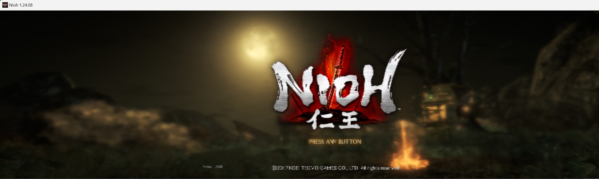
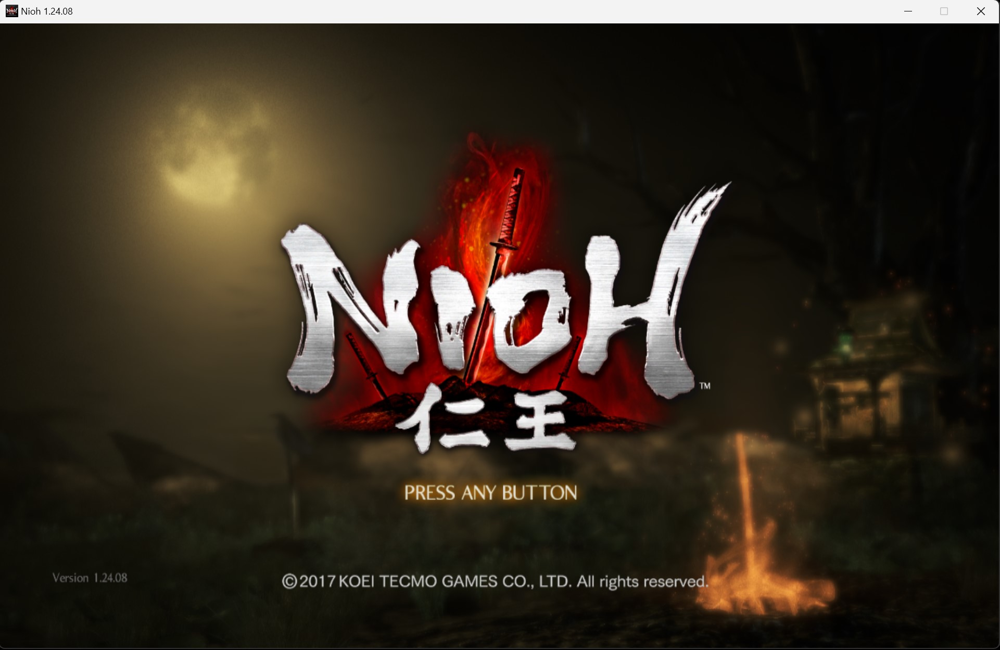

# Nioh-Complete-Edition-Any-Aspect-Ratio

In the Nioh launcher, set **Screen Resolution to 1920x1080** and **Render
Resolution to High**. The mod replaces that entry with your own resolution.

## Install

Extract the ZIP into the game folder, beside `nioh.exe`. `nioh.exe` itself is
not modified.

## SteamOS / Winlator

Launch option: `WINEDLLOVERRIDES="dinput8=n,b" %command%`

## Custom Aspect Ratio

Edit `Width` and `Height` in `[Resolution]` in `Nioh_ARFix.ini`. The default is
1280x800 (16:10).

`RenderScale` sets the internal render resolution (Width/Height x RenderScale).
Use a value below 1.0 for better performance; the UI is not affected.

Built for Nioh v1.24.07 and newer. Missing patches are logged to
`Nioh_ARFix.log`.
