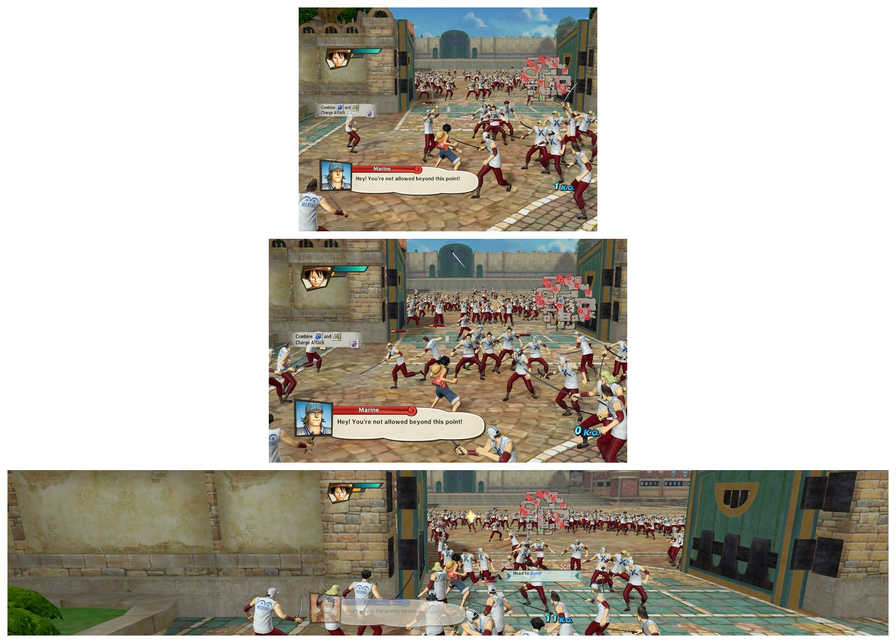

# ONE-PIECE-PIRATE-WARRIORS-3-Any-Aspect-Ratio

 

Fills the screen at any aspect ratio. The HUD, menus and movies keep their 16:9 shape, and screens narrower than 16:9 get extra view above and below.

# Install
Extract the mod files directly into your Steam game folder (where oppw3.exe is located).

Fullscreen and windowed both work. The in-game resolution setting is ignored; the mod sets the resolution.

# For SteamOS / Winlator (Wine Users)
For Steam Deck / SteamOS, open the game's Properties, then General > Launch Options, and use:
`WINEDLLOVERRIDES="dinput8=n,b" %command%`

For Winlator / Wine, add this environment variable to the game or container settings:
Name: WINEDLLOVERRIDES
Value: dinput8=n,b

# Custom Aspect Ratio
Open OPPW3_ARFix.ini with any text editor. Width and Height set the resolution (e.g., 4:3, 16:10, 21:9); 0 uses your screen size.

Multiplier under [FOV] changes the field of view: 1.0 is the normal view, 1.1 shows 10% more (0.5 to 2.0).
