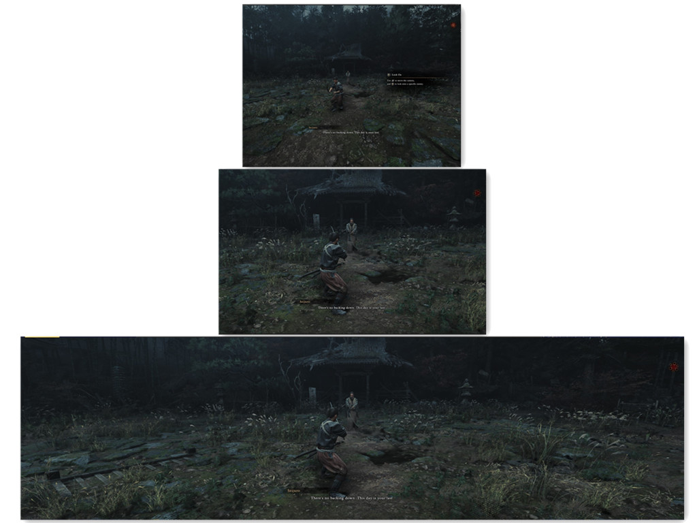

# ONIMUSHA-WAY-OF-THE-SWORD-Any-Aspect-Ratio

 

Why?
- REFramework is incompatible with ARM64EC containers and can crash when its x86 instrumentation is dispatched. This mod removes the letterbox without relying on REFramework.

## 1. Install

Extract the ZIP into the game folder, beside `OnimushaWotS.exe`.

## 2. Optional: SteamOS / Proton / Winlator / macOS

Launch option: `WINEDLLOVERRIDES="dinput8=n,b" %command%`

## 3. Custom Aspect Ratio

Edit `Width` and `Height` in `[Window]` in `OnimushaWotS_ARFix.ini`. The default is
1280x800 (16:10). The game runs in a borderless window of that size and fills
it without black bars. Set `Borderless = false` to keep window borders.

## 4. FOV

Set `FOVScale` in `[FOV]` (default 1.0, range 0 - 2.0) to widen or narrow the camera view.

The bundled dinput8.dll is from Ultimate ASI Loader. Its MIT license is included in the ZIP and in the repository root.
