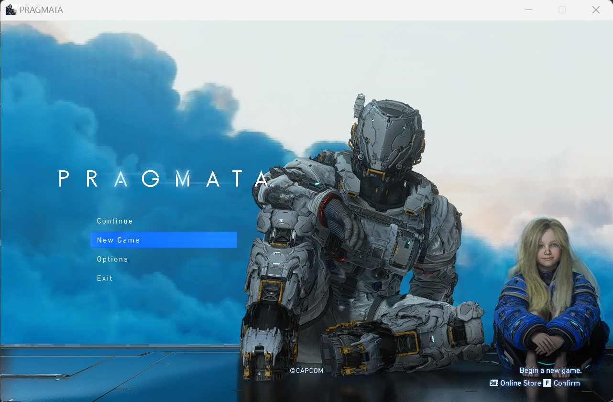
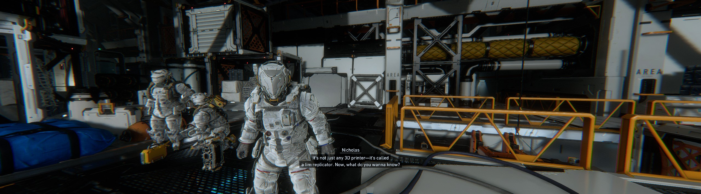

# PRAGMATA-Any-Aspect-Ratio

## 1. Install

Extract the ZIP into the game folder, beside `PRAGMATA.exe`.

## 2. Options: SteamOS / Proton / Winlator / macOS

Launch option: `WINEDLLOVERRIDES="dinput8=n,b" %command%`

## 3. Custom Aspect Ratio

Edit `Width` and `Height` in `[Window]` in `PRAGMATA_ARFix.ini`. The default is
1280x800 (16:10). The game runs in a borderless window of that size and fills
it without black bars. Set `Borderless = false` to keep window borders.
