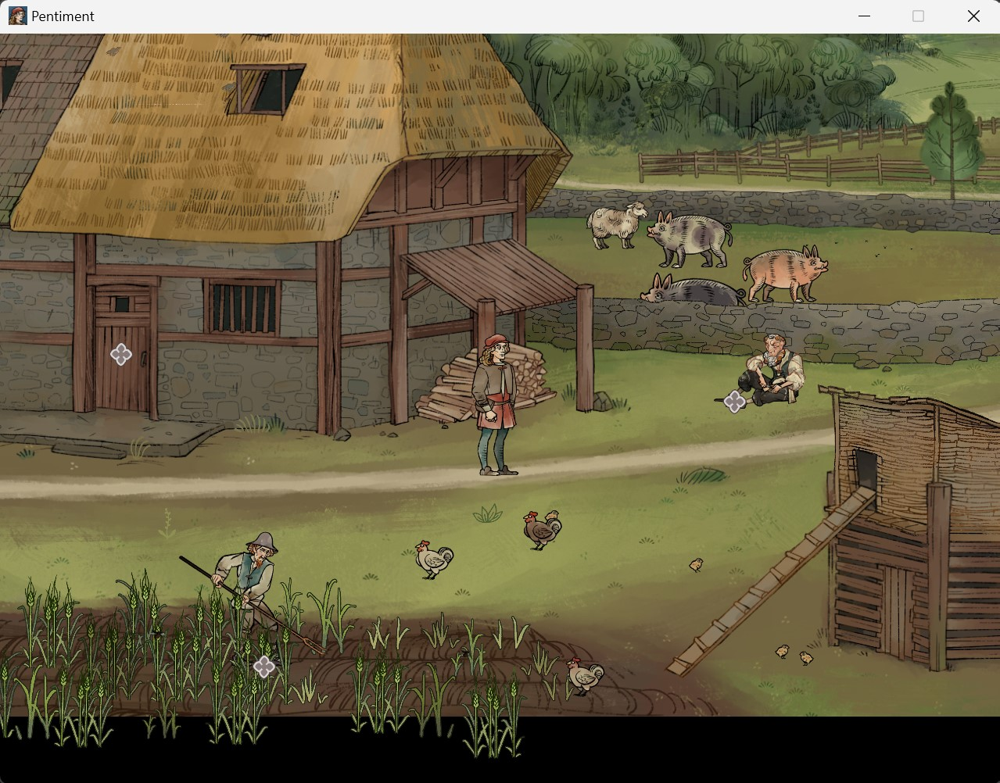
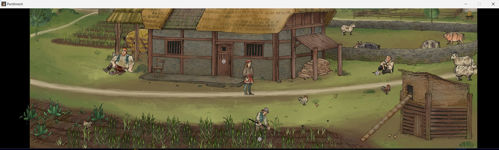

# Pentiment-Any-Aspect-Ratio

[](https://github.com/TLin-Y/SteamAnyAspectRatioMods) [](https://ko-fi.com/lin66961)

Aspect-ratio fix v0.2.1 for Pentiment

## Demo





## Install

1. Extract `Pentiment-v0.2.1.zip` into the game folder containing `Pentiment.exe`.
2. On SteamOS / Proton, set the Steam launch option to:
   `WINEDLLOVERRIDES="winhttp=n,b" %command%`
3. On Winlator, add the environment variable `WINEDLLOVERRIDES` with value `winhttp=n,b`.

## Custom Aspect Ratio

Edit `Pentiment_ARFix.ini`. Positive dimensions request a windowed resolution on startup. The default is 1280x800 (16:10); set both dimensions to `0` to retain the game's resolution and fullscreen settings.

```ini
[AspectRatio]
Enabled = true

[Resolution]
Width = 1280
Height = 800
Borderless = true
```

Restart the game after editing the INI. Set `Enabled = false` to disable every hook.
