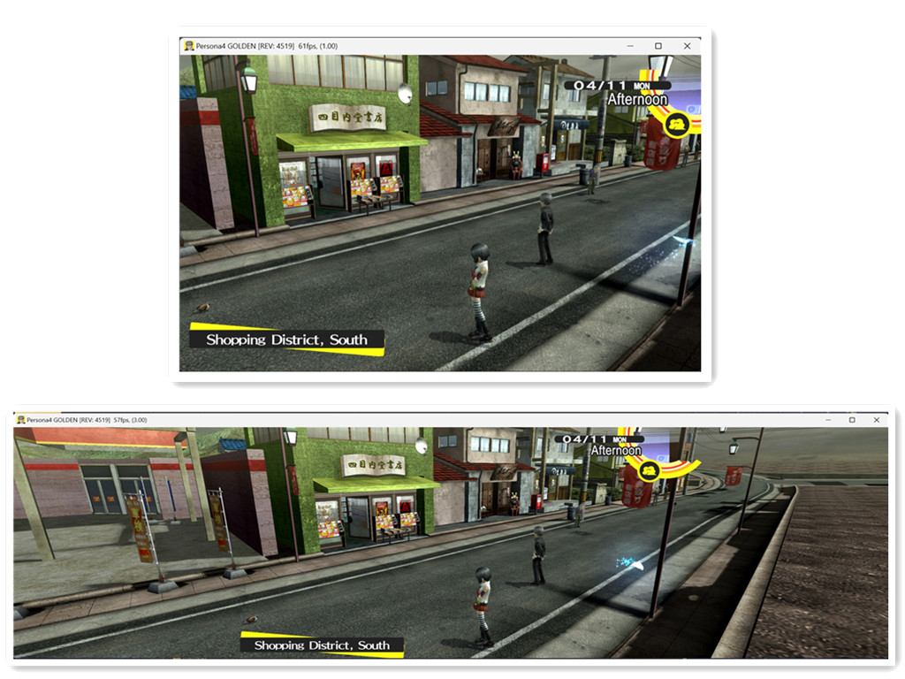

# PERSONA-4-GOLDEN-Any-Aspect-Ratio

## 1. Install

Extract the ZIP into the game folder, beside `P4G.exe`.

## 2. Optional: SteamOS / Proton / Winlator / macOS

Launch option: `WINEDLLOVERRIDES="dinput8=n,b" %command%`

## 3. Custom Aspect Ratio

Edit `Width` and `Height` in `[Resolution]` in `P4G_ARFix.ini`. The default is
1280x800 (16:10, Steam Deck). The game starts at this resolution in a borderless
window centred on the screen, even if your monitor does not list it (use your
monitor's resolution for borderless fullscreen). `Width = 0` and `Height = 0`
keep the resolution and Screen Mode chosen in Config > Display.

The 3D scene fills the whole screen: taller screens (16:10, 4:3) show more above
and below, wider ones (21:9, 32:9) show more to the sides. Menus, text boxes,
portraits and the HUD keep their original 16:9 shape, so nothing is stretched.
Set `VerticalAlign` in `[Interface]` to `Top`, `Center` (default) or `Bottom` to
move them. Screen tints and fades cover the whole screen.

On taller screens the dialogue box, character portraits, the date/weather
indicator and the party icons are moved to the screen edges (dialogue to the
bottom, date and party icons up). Set `AnchorHUD = false` in `[Interface]` to keep them with the rest of
the interface.

The TV-world static and scanline effect is off by default; set `TVFilter = 1` in
`[Interface]` to show it across the whole screen. Movies keep their 16:9 shape
with black bars.

The game saves the resolution it last ran at in its own settings. After
removing the mod, pick your resolution again in Config > Display.

Made for the current Steam version (64-bit).
