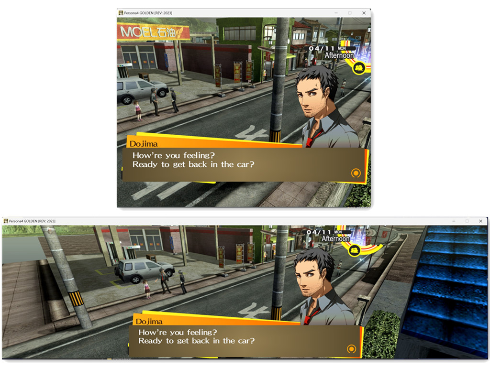

# PERSONA-4-GOLDEN-Any-Aspect-Ratio

## 1. Install

Extract the ZIP into the game folder, beside `P4G.exe`.

## 2. Optional: SteamOS / Proton / Winlator / macOS

Launch option: `WINEDLLOVERRIDES="dinput8=n,b" %command%`

## 3. Custom Aspect Ratio

Edit `Width` and `Height` in `[Resolution]` in `P4G_ARFix.ini`. The default is
1280x800 (16:10, Steam Deck). `Width = 0` and `Height = 0` use the monitor
resolution.

The mod adds this resolution to the game's resolution list. If black bars
remain, select it in the game's Config menu.

The 3D scene fills the whole screen: taller screens (16:10, 4:3) show more above
and below, wider ones (21:9, 32:9) show more to the sides. Menus, text boxes,
portraits and the HUD keep their original 16:9 shape in the centre of the
screen, so nothing is stretched. Screen tints and fades cover the whole screen.
