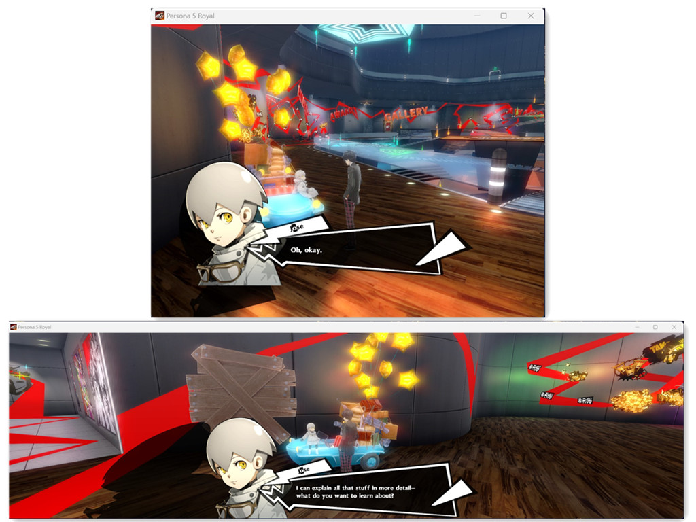

# PERSONA-5-ROYAL-Any-Aspect-Ratio

## 1. Install

Extract the ZIP into the game folder, beside `P5R.exe`.

## 2. Optional: SteamOS / Proton / Winlator / macOS

Launch option: `WINEDLLOVERRIDES="dinput8=n,b" %command%`

## 3. Custom Aspect Ratio

Set the game's display mode to **Windowed** (required).

Edit `Width` and `Height` in `[Resolution]` in `P5R_ARFix.ini`. The default is
1280x800 (16:10, Steam Deck). Use your screen resolution and set the game
window to the same size. `Width = 0` and `Height = 0` use the resolution
selected in the game's Config menu.

The 3D scene fills the whole screen: taller screens (16:10, 4:3) show more above
and below, wider ones (21:9, 32:9) show more to the sides. Menus, text boxes,
portraits and the HUD keep their original 16:9 shape, so nothing is stretched.
Set `VerticalAlign` in `[Interface]` to `Top`, `Center` (default) or `Bottom` to
move them. Menu backgrounds, screen tints and fades cover the whole screen.

The black event bars are hidden; set `EventBars = 1` to keep them. `FOV` in
`[Camera]` scales the field of view (default 1.0, lower zooms in).

## 4. Text Size

`TextScale` in `[Interface]` sets the game text size (default 1.3, range 0.5
to 2.0; 1.0 is the original size). Text drawn as images (button hints, menu titles)
keeps its size.

`HideNextArrow = true` (default) hides the big white arrow at the right of the
dialogue box, which covers the end of long lines of large text. Set it to `false`
to keep the arrow.

No SteamOS "Stretch" scaling is needed any more (it was required by v1.0.0).
