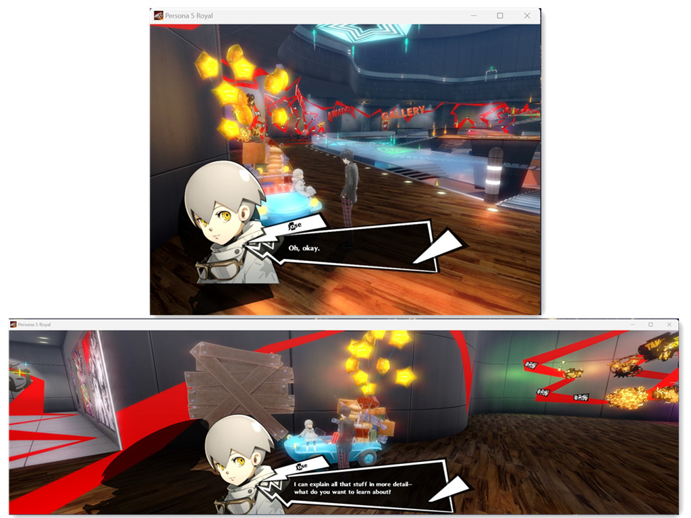

# PERSONA-5-ROYAL-Any-Aspect-Ratio

## 1. Install

Extract the ZIP into the game folder, beside `P5R.exe`.

## 2. Optional: SteamOS / Proton / Winlator / macOS

Launch option: `WINEDLLOVERRIDES="dinput8=n,b" %command%`

## 3. Custom Aspect Ratio

Edit `Width` and `Height` in `[Resolution]` in `P5R_ARFix.ini`. The default is
1280x800 (16:10, Steam Deck). Use your screen resolution and play in full
screen, or set the game window to the same size. `Width = 0` and `Height = 0`
use the resolution selected in the game's Config menu.

The 3D scene fills the whole screen: taller screens (16:10, 4:3) show more above
and below, wider ones (21:9, 32:9) show more to the sides. Menus, text boxes,
portraits and the HUD keep their original 16:9 shape in the centre of the
screen, so nothing is stretched. Menu backgrounds, screen tints and fades cover
the whole screen.

No SteamOS "Stretch" scaling is needed any more (it was required by v1.0.0).
