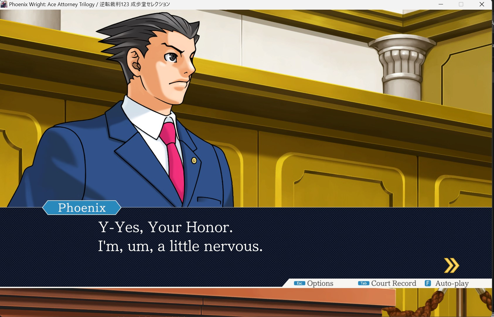
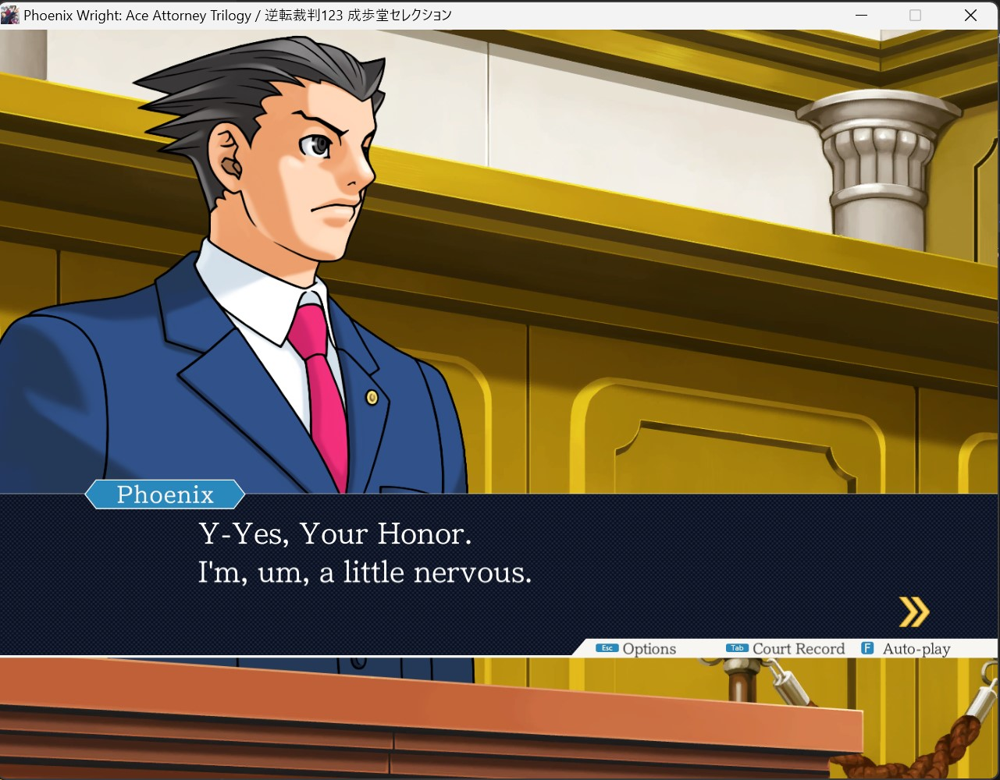

# PHOENIX-WRIGHT-ACE-ATTORNEY-TRILOGY-Any-Aspect-Ratio

## Demo




## Install

1. Close the game. Back up `PWAAT_Data\Managed\Assembly-CSharp.dll`
   as `Assembly-CSharp.dll.pwaat-original.bak`.
2. Extract the ZIP beside `PWAAT.exe`, merging folders.
3. Launch normally through Steam. No launch option is needed.

## Custom Aspect Ratio

Edit `PWAAT_ARFix.ini`, then restart. Default is 1280x800 (16:10):

```ini
[Resolution]
Width = 1280
Height = 800
ToggleKey = F10
```

The size is applied at every launch and added to the in-game resolution
list. Set both to `0` to keep the in-game setting.

Below 16:9 (16:10, 4:3) the scene fills the screen, while the textbox and
HUD keep their full 16:9 layout. The title screen and menus stay letterboxed.

Why the scene is cropped: the game only has 16:9 art, with nothing drawn
above or below it. To fill a taller screen without black bars or stretching,
the scene is zoomed until it is as tall as the screen, which trims a little
from the left and right edges (about 5% per side at 16:10, 12.5% at 4:3).

The game's art is 16:9 only. Wider than 16:9 shows black at the sides
because there is nothing to display there; this is expected.

## Toggle crop (F10)

Something you need to examine or select can sit in the cropped edge area.
Press `F10` in game to switch between the cropped (full screen) view and the
full 16:9 width with bars, and press it again to go back. On Steam Deck, map
a back button to `F10` in the Steam Input layout. Change the key with
`ToggleKey` in `PWAAT_ARFix.ini` (Unity key names, e.g. `F9`, `Home`).

## Remove

Delete `PWAAT_Data\Managed\PWAATResolution.dll` and `PWAAT_ARFix.ini`, then
rename `Assembly-CSharp.dll.pwaat-original.bak` back to `Assembly-CSharp.dll`.
