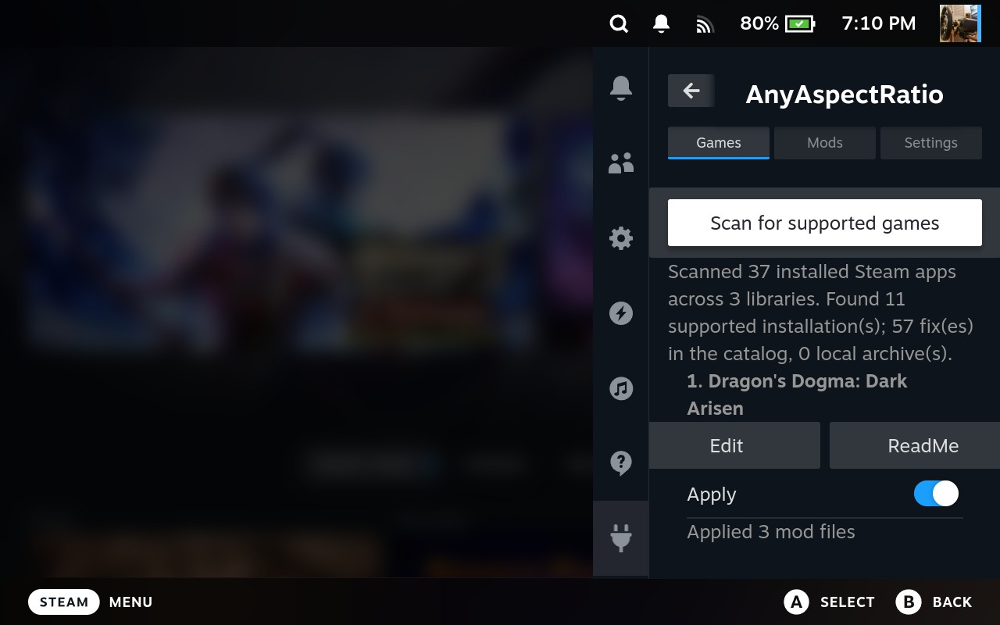

# SteamAnyAspectRatioMods

Play your favorite games at the aspect ratio you want, on the platform you choose. This collection provides easy to use, cross platform aspect ratio fixes for games in Proton/Wine/Linux/MacOS/SteamOS/Windows.

On Steam Deck, the [AnyAspectRatio Decky plugin](./AnyAspectRatioDecky/README.md) applies these fixes for you in one tap:

## Support

If these fixes make your games better, you can support the author:

Fixes by [Lyall](https://codeberg.org/Lyall) are mirrored here unchanged for the Decky plugin; please support him too: [Patreon](https://www.patreon.com/Wintermance) | [Ko-fi](https://ko-fi.com/W7W01UAI9)

## About this collection

Before looking for a fix here, check [Lyall's repository](https://codeberg.org/Lyall): it contains many ready-made fixes for a wide range of games. This collection focuses mainly on filling handheld-specific gaps and adapting mods for devices such as Steam Deck, AYN, and Retroid Pocket.

## Credits

This repository includes original fixes as well as work based on and distributed alongside projects by other authors. Individual game READMEs document game-specific sources, contributors, and notices.

Our thanks to the creators of the external mods are in [external/THANKS.md](./external/THANKS.md).

- **Lyall** — source code, patterns, and fixes reused or adapted in this repository, including [Sky1stChapterFix](https://codeberg.org/Lyall/Sky1stChapterFix), [NinjaGaidenMCFix](https://codeberg.org/Lyall/NinjaGaidenMCFix), and other [Lyall fixes](https://codeberg.org/Lyall). See the [compiler notes](./compiler/README.md) for the derived-source details and license.
- **ThirteenAG** — [Ultimate ASI Loader](https://github.com/ThirteenAG/Ultimate-ASI-Loader), included by some game mods to load ASI plugins.
- **Compiler dependencies** — [inipp](https://github.com/mcmtroffaes/inipp), [SafetyHook](https://github.com/cursey/safetyhook), [spdlog](https://github.com/gabime/spdlog), [Zydis](https://github.com/zyantific/zydis), and [Zycore](https://github.com/zyantific/zycore) (used by Zydis). The compiler setup pins specific upstream revisions.
- **Twig** — [Undertale Ultrawide Fix](https://steamcommunity.com/sharedfiles/filedetails/?id=2953302517).
- **TechieW** — [Elden Ring Ultrawide Fix](https://www.nexusmods.com/eldenring/mods/7870), for offline play.
- **MinuteReversal**, **TEODORMAX**, **ellekz**, **Nozomi Miyamori**, and **Fiend Busa**.

## In action

Resident Evil 3 running on a handheld:

## Building another ASI fix

The reusable Windows/x64 ASI compiler is in [compiler](./compiler/README.md). Its build files and dependencies are isolated from the game mods in this repository. The sample implementation is based on the clean source layout of Lyall's [Sky1stChapterFix](https://codeberg.org/Lyall/Sky1stChapterFix); replace `compiler/dllmain.cpp` and set `compiler/build_config.json` for each game. Lyall's license and attribution remain with the derived source, while the generated plugin's version metadata identifies AnyAspectRatio as its publisher.

## License

The [MIT License](./LICENSE) applies only to original code and documentation authored by TLin-Y, unless a file or directory states otherwise. It does not grant rights to third-party code, game files, or other assets. The compiler's Lyall-derived files and the bundled Ultimate ASI Loader each retain their separate license and attribution.

## Game Mods

| Game | Author | Steam ID | Version | Released | Details |
|---|---|---|---|---|---|
| Absolum | Lyall | [1904480](https://store.steampowered.com/app/1904480) | [v0.0.2](./external/Lyall/AbsolumFix/AbsolumFix_0.0.2.zip) | 2026-02-12 | [AbsolumFix](https://codeberg.org/Lyall/AbsolumFix) |
| AI: THE SOMNIUM FILES - nirvanA Initiative | Lyall | [1449200](https://store.steampowered.com/app/1449200) | [v1.0.7](./external/Lyall/AISomniumFiles2Fix/AISomniumFiles2Fix_1.0.7.zip) | 2025-07-07 | [AISomniumFiles2Fix](https://codeberg.org/Lyall/AISomniumFiles2Fix) |
| Assassin’s Creed Shadows | Lyall | [3159330](https://store.steampowered.com/app/3159330) | [v0.0.8](./external/Lyall/ACShadowsFix/ACShadowsFix_0.0.8.zip) | 2026-06-17 | [ACShadowsFix](https://codeberg.org/Lyall/ACShadowsFix) |
| Atelier Yumia: The Alchemist of Memories & the Envisioned Land | Lyall | [3123410](https://store.steampowered.com/app/3123410) | [v0.0.6](./external/Lyall/AtelierYumiaFix/AtelierYumiaFix_0.0.6.zip) | 2025-05-31 | [AtelierYumiaFix](https://codeberg.org/Lyall/AtelierYumiaFix) |
| Beast of Reincarnation | Lyall | [2001760](https://store.steampowered.com/app/2001760) | [v0.0.6](./external/Lyall/BeastOfReincarnationFix/BeastOfReincarnationFix_0.0.6.zip) | 2026-08-26 | [BeastOfReincarnationFix](https://codeberg.org/Lyall/BeastOfReincarnationFix) |
| Binary Domain | Lyall | [203750](https://store.steampowered.com/app/203750) | [v0.0.2](./external/Lyall/BinaryDomainFix/BinaryDomainFix_0.0.2.zip) | 2026-07-30 | [BinaryDomainFix](https://codeberg.org/Lyall/BinaryDomainFix) |
| Black Myth: Wukong | Lyall | [2358720](https://store.steampowered.com/app/2358720) | [v0.8.5](./external/Lyall/WukongTweak/WukongTweak_0.8.5.zip) | 2025-06-04 | [WukongTweak](https://codeberg.org/Lyall/WukongTweak) |
| BRAVELY DEFAULT FLYING FAIRY HD Remaster | Lyall | [2833580](https://store.steampowered.com/app/2833580) | [v0.0.1](./external/Lyall/BDFFHDFix/BDFFHDFix_0.0.1.zip) | 2026-04-30 | [BDFFHDFix](https://codeberg.org/Lyall/BDFFHDFix) |
| BRAVELY DEFAULT II | Lyall | [1446650](https://store.steampowered.com/app/1446650) | [v0.0.4](./external/Lyall/BravelyDefault2Fix/BravelyDefault2Fix_0.0.4.zip) | 2025-06-21 | [BravelyDefault2Fix](https://codeberg.org/Lyall/BravelyDefault2Fix) |
| Clair Obscur: Expedition 33 | Lyall | [1903340](https://store.steampowered.com/app/1903340) | [v0.0.15](./external/Lyall/ClairObscurFix/ClairObscurFix_0.0.15.zip) | 2025-12-22 | [ClairObscurFix](https://codeberg.org/Lyall/ClairObscurFix) |
| Dark Souls III (Offline) | TLin-Y (fullscreen fix by ellekz) | [374320](https://store.steampowered.com/app/374320) | [v1.1.0](./Dark%20Souls%20III/Dark-Souls-III-v1.1.0.zip) | 2026-11-03 | [README](./Dark%20Souls%20III/README.md) |
| DEAD OR ALIVE 5 Last Round: Core Fighters | Lyall | [311730](https://store.steampowered.com/app/311730) | [v0.0.1](./external/Lyall/DOA5LRFix/DOA5LRFix_0.0.1.zip) | 2025-11-30 | [DOA5LRFix](https://codeberg.org/Lyall/DOA5LRFix) |
| DEAD OR ALIVE 6 | Lyall | [838380](https://store.steampowered.com/app/838380) | [v0.0.1](./external/Lyall/DOA6Fix/DOA6Fix_0.0.1.zip) | 2025-12-08 | [DOA6Fix](https://codeberg.org/Lyall/DOA6Fix) |
| DEATH STRANDING 2: ON THE BEACH | Lyall | [3280350](https://store.steampowered.com/app/3280350) | [v0.0.5](./external/Lyall/DeathStranding2Fix/DeathStranding2Fix_0.0.5.zip) | 2026-06-12 | [DeathStranding2Fix](https://codeberg.org/Lyall/DeathStranding2Fix) |
| DEATH STRANDING DIRECTOR'S CUT | Lyall | [1850570](https://store.steampowered.com/app/1850570) | [v0.0.2](./external/Lyall/DeathStrandingDCFix/DeathStrandingDCFix_0.0.2.zip) | 2025-07-04 | [DeathStrandingDCFix](https://codeberg.org/Lyall/DeathStrandingDCFix) |
| Deus Ex: Mankind Divided | Lyall | [337000](https://store.steampowered.com/app/337000) | [v0.0.4](./external/Lyall/DeusExMDFix/DeusExMDFix_0.0.4.zip) | 2025-06-02 | [DeusExMDFix](https://codeberg.org/Lyall/DeusExMDFix) |
| Dragon Age II | Lyall | [1238040](https://store.steampowered.com/app/1238040) | [v0.0.3](./external/Lyall/DAFix/DAFix_0.0.3.zip) | 2025-06-04 | [DAFix](https://codeberg.org/Lyall/DAFix) |
| Dragon Age: Origins | Lyall | [47810](https://store.steampowered.com/app/47810) | [v0.0.3](./external/Lyall/DAFix/DAFix_0.0.3.zip) | 2025-06-04 | [DAFix](https://codeberg.org/Lyall/DAFix) |
| DRAGON BALL XENOVERSE 2 | Lyall | [454650](https://store.steampowered.com/app/454650) | [v0.0.2](./external/Lyall/DBXV2Fix/DBXV2Fix_0.0.2.zip) | 2026-01-23 | [DBXV2Fix](https://codeberg.org/Lyall/DBXV2Fix) (manual install) |
| DRAGON QUEST III HD-2D Remake | Lyall | [2701660](https://store.steampowered.com/app/2701660) | [v0.0.4](./external/Lyall/DQ3Fix/DQ3Fix_0.0.4.zip) | 2025-06-04 | [DQ3Fix](https://codeberg.org/Lyall/DQ3Fix) |
| DRAGON QUEST TREASURES | Lyall | [2021210](https://store.steampowered.com/app/2021210) | [v0.0.4](./external/Lyall/DQTreasuresFix/DQTreasuresFix_0.0.4.zip) | 2025-06-04 | [DQTreasuresFix](https://codeberg.org/Lyall/DQTreasuresFix) |
| DRAGON QUEST VII Reimagined | Lyall | [2499860](https://store.steampowered.com/app/2499860) | [v0.0.5](./external/Lyall/DQ7RFix/DQ7RFix_0.0.5.zip) | 2026-03-10 | [DQ7RFix](https://codeberg.org/Lyall/DQ7RFix) |
| DRAGON QUEST XI S: Echoes of an Elusive Age - Definitive Edition | Lyall | [1295510](https://store.steampowered.com/app/1295510) | [v0.9.3](./external/Lyall/DQXISFix/DQXISFix_0.9.3.zip) | 2026-01-18 | [DQXISFix](https://codeberg.org/Lyall/DQXISFix) |
| Dragon's Dogma: Dark Arisen | Lyall | [367500](https://store.steampowered.com/app/367500) | [v0.9.1](./external/Lyall/DDDAFix/DDDAFix_0.9.1.zip) | 2025-06-21 | [DDDAFix](https://codeberg.org/Lyall/DDDAFix) |
| Dynasty Warriors 3: Complete Edition Remastered | TLin-Y | [3841510](https://store.steampowered.com/app/3841510) | [v1.1.0](./Dynasty%20Warriors%203%20Remastered/DW3RE-v1.1.0.zip) | 2026-11-03 | [README](./Dynasty%20Warriors%203%20Remastered/README.md) |
| Dynasty Warriors: Origins | TLin-Y | [2384580](https://store.steampowered.com/app/2384580) | [v1.0.0](./Dynasty%20Warriors%20Origins/Dynasty-Warriors-Origins-v1.0.0.zip) | 2026-11-02 | [README](./Dynasty%20Warriors%20Origins/README.md) |
| Eiyuden Chronicle: Hundred Heroes | Lyall | [1658280](https://store.steampowered.com/app/1658280) | [v0.9.8](./external/Lyall/HundredHeroesFix/HundredHeroesFix_0.9.8.zip) | 2025-06-06 | [HundredHeroesFix](https://codeberg.org/Lyall/HundredHeroesFix) |
| Elden Ring (Offline) | TechieW | [1245620](https://store.steampowered.com/app/1245620) | [v1.0.1](./external/TechieW/ELDEN%20RING/Elden%20Ring%20Ultrawide%20Fix-7870-1-0-1-1746293446.zip) | 2025-05-03 | [README](./external/TechieW/ELDEN%20RING/README.md) |
| FATAL FRAME II: Crimson Butterfly REMAKE | Lyall | [3920610](https://store.steampowered.com/app/3920610) | [v0.0.2](./external/Lyall/FF2RFix/FF2RFix_0.0.2.zip) | 2026-03-13 | [FF2RFix](https://codeberg.org/Lyall/FF2RFix) |
| Fate/Samurai Remnant | Lyall | [1902690](https://store.steampowered.com/app/1902690) | [v0.0.2](./external/Lyall/FateSamuraiRemnantFix/FateSamuraiRemnantFix_0.0.2.zip) | 2025-06-01 | [FateSamuraiRemnantFix](https://codeberg.org/Lyall/FateSamuraiRemnantFix) |
| FINAL FANTASY VII REBIRTH | Lyall | [2909400](https://store.steampowered.com/app/2909400) | [v0.0.13](./external/Lyall/FF7RebirthFix/FF7RebirthFix_0.0.13.zip) | 2026-06-04 | [FF7RebirthFix](https://codeberg.org/Lyall/FF7RebirthFix) |
| FINAL FANTASY VII REMAKE INTERGRADE | Lyall | [1462040](https://store.steampowered.com/app/1462040) | [v0.0.2](./external/Lyall/FF7RemakeFix/FF7RemakeFix_0.0.2.zip) | 2026-01-30 | [FF7RemakeFix](https://codeberg.org/Lyall/FF7RemakeFix) |
| Final Fantasy XIII | TLin-Y | [292120](https://store.steampowered.com/app/292120) | [v1.0.0](./Final%20Fantasy%20XIII/Final-Fantasy-XIII-v1.0.0.zip) | 2026-11-02 | [README](./Final%20Fantasy%20XIII/README.md) |
| Final Fantasy XIII-2 | TEODORMAX | [292140](https://store.steampowered.com/app/292140) | [v1.4.0](./external/TEODORMAX/FFXIII2UW/FFXIII2UW_1.4.0.zip) | 2026-07-17 | [FFXIII2UW](https://www.nexusmods.com/finalfantasyxiii2/mods/42) |
| FINAL FANTASY XVI | Lyall | [2515020](https://store.steampowered.com/app/2515020) | [v0.8.5](./external/Lyall/FFXVIFix/FFXVIFix_0.8.5.zip) | 2025-06-05 | [FFXVIFix](https://codeberg.org/Lyall/FFXVIFix) |
| Granblue Fantasy: Relink | Lyall | [881020](https://store.steampowered.com/app/881020) | [v1.1.5](./external/Lyall/GBFRelinkFix/GBFRelinkFix_1.1.5.zip) | 2026-08-07 | [GBFRelinkFix](https://codeberg.org/Lyall/GBFRelinkFix) |
| Hatsune Miku: Project DIVA Mega Mix+ | Lyall | [1761390](https://store.steampowered.com/app/1761390) | [v0.0.1](./external/Lyall/MegaMixPlusFix/MegaMixPlusFix_0.0.1.zip) | 2025-06-01 | [MegaMixPlusFix](https://codeberg.org/Lyall/MegaMixPlusFix) |
| Indiana Jones and the Great Circle | Lyall | [2677660](https://store.steampowered.com/app/2677660) | [v0.0.8](./external/Lyall/GreatCircleFix/GreatCircleFix_0.0.8.zip) | 2025-06-01 | [GreatCircleFix](https://codeberg.org/Lyall/GreatCircleFix) |
| Judgment | Lyall | [2058180](https://store.steampowered.com/app/2058180) | [v0.0.6](./external/Lyall/DragonTweak/DragonTweak_0.0.6.zip) | 2026-01-21 | [DragonTweak](https://codeberg.org/Lyall/DragonTweak) (manual install) |
| LEGO Batman: Legacy of the Dark Knight | Lyall | [2215200](https://store.steampowered.com/app/2215200) | [v0.0.4](./external/Lyall/LEGOBatmanLotDKFix/LEGOBatmanLotDKFix_0.0.4.zip) | 2026-09-17 | [LEGOBatmanLotDKFix](https://codeberg.org/Lyall/LEGOBatmanLotDKFix) |
| Lightning Returns: Final Fantasy XIII | TEODORMAX | [345350](https://store.steampowered.com/app/345350) | [v1.0.0](./external/TEODORMAX/UltrawideFix-LRFF13/UltrawideFix-LRFF13_1.0.0.zip) | 2026-07-28 | [UltrawideFix](https://www.nexusmods.com/lightningreturnsfinalfantasy13/mods/35) |
| Like a Dragon Gaiden: The Man Who Erased His Name | Lyall | [2375550](https://store.steampowered.com/app/2375550) | [v0.0.6](./external/Lyall/DragonTweak/DragonTweak_0.0.6.zip) | 2026-01-21 | [DragonTweak](https://codeberg.org/Lyall/DragonTweak) (manual install) |
| Like a Dragon: Infinite Wealth | Lyall | [2072450](https://store.steampowered.com/app/2072450) | [v0.0.6](./external/Lyall/DragonTweak/DragonTweak_0.0.6.zip) | 2026-01-21 | [DragonTweak](https://codeberg.org/Lyall/DragonTweak) (manual install) |
| Like a Dragon: Pirate Yakuza in Hawaii | Lyall | [3061810](https://store.steampowered.com/app/3061810) | [v0.0.6](./external/Lyall/DragonTweak/DragonTweak_0.0.6.zip) | 2026-01-21 | [DragonTweak](https://codeberg.org/Lyall/DragonTweak) (manual install) |
| Lost Judgment | Lyall | [2058190](https://store.steampowered.com/app/2058190) | [v0.0.6](./external/Lyall/DragonTweak/DragonTweak_0.0.6.zip) | 2026-01-21 | [DragonTweak](https://codeberg.org/Lyall/DragonTweak) (manual install) |
| Mandragora: Whispers of the Witch Tree | Lyall | [1721060](https://store.steampowered.com/app/1721060) | [v0.0.2](./external/Lyall/MandragoraFix/MandragoraFix_0.0.2.zip) | 2025-05-29 | [MandragoraFix](https://codeberg.org/Lyall/MandragoraFix) |
| Master Detective Archives: RAIN CODE Plus | Lyall | [2903950](https://store.steampowered.com/app/2903950) | [v0.0.1](./external/Lyall/MDARainCodePlusFix/MDARainCodePlusFix_0.0.1.zip) | 2025-06-01 | [MDARainCodePlusFix](https://codeberg.org/Lyall/MDARainCodePlusFix) |
| METAL GEAR SOLID V: GROUND ZEROES | Lyall | [311340](https://store.steampowered.com/app/311340) | [v0.0.3](./external/Lyall/MGSVFix/MGSVFix_0.0.3.zip) | 2026-06-11 | [MGSVFix](https://codeberg.org/Lyall/MGSVFix) |
| METAL GEAR SOLID V: THE PHANTOM PAIN | Lyall | [287700](https://store.steampowered.com/app/287700) | [v0.0.3](./external/Lyall/MGSVFix/MGSVFix_0.0.3.zip) | 2026-06-11 | [MGSVFix](https://codeberg.org/Lyall/MGSVFix) |
| METAL GEAR SOLID Δ: SNAKE EATER | Lyall | [2417610](https://store.steampowered.com/app/2417610) | [v0.0.6](./external/Lyall/MGSDeltaFix/MGSDeltaFix_0.0.6.zip) | 2025-11-01 | [MGSDeltaFix](https://codeberg.org/Lyall/MGSDeltaFix) |
| Metaphor: ReFantazio | Lyall | [2679460](https://store.steampowered.com/app/2679460) | [v0.8.5](./external/Lyall/MetaphorFix/MetaphorFix_0.8.5.zip) | 2025-06-04 | [MetaphorFix](https://codeberg.org/Lyall/MetaphorFix) |
| Monster Hunter Rise | TLin-Y | [1446780](https://store.steampowered.com/app/1446780) | [v1.1.0](./Monster%20Hunter%20Rise/Monster-Hunter-Rise-v1.1.0.zip) | 2026-11-03 | [README](./Monster%20Hunter%20Rise/README.md) |
| Monster Hunter: World | MinuteReversal | [582010](https://store.steampowered.com/app/582010) | [v0.11.13](./external/MinuteReversal/MHW16x10Fix/MHW16x10Fix_0.11.13.zip) | 2026-10-27 | [MHW16x10Fix](https://github.com/MinuteReversal/MHW16x10Fix) |
| Ni no Kuni II: Revenant Kingdom | Lyall | [589360](https://store.steampowered.com/app/589360) | [v0.0.1](./external/Lyall/NiNoKuni2Fix/NiNoKuni2Fix_0.0.1.zip) | 2026-08-15 | [NiNoKuni2Fix](https://codeberg.org/Lyall/NiNoKuni2Fix) |
| Ni no Kuni Wrath of the White Witch Remastered | Lyall | [798460](https://store.steampowered.com/app/798460) | [v0.0.1](./external/Lyall/NiNoKuniFix/NiNoKuniFix_0.0.1.zip) | 2026-05-17 | [NiNoKuniFix](https://codeberg.org/Lyall/NiNoKuniFix) |
| NieR Replicant ver.1.22474487139... | Lyall | [1113560](https://store.steampowered.com/app/1113560) | [v0.0.1](./external/Lyall/NierReplicantFix/NierReplicantFix_0.0.1.zip) | 2026-05-26 | [NierReplicantFix](https://codeberg.org/Lyall/NierReplicantFix) |
| NINJA GAIDEN 3: Razor's Edge | Lyall | [1369760](https://store.steampowered.com/app/1369760) | [v0.0.1](./external/Lyall/NinjaGaidenMCFix/NinjaGaidenMCFix_0.0.1.zip) | 2025-06-19 | [NinjaGaidenMCFix](https://codeberg.org/Lyall/NinjaGaidenMCFix) |
| NINJA GAIDEN Sigma | Lyall | [1580780](https://store.steampowered.com/app/1580780) | [v0.0.1](./external/Lyall/NinjaGaidenMCFix/NinjaGaidenMCFix_0.0.1.zip) | 2025-06-19 | [NinjaGaidenMCFix](https://codeberg.org/Lyall/NinjaGaidenMCFix) |
| Ninja Gaiden Sigma 2 | Nozomi Miyamori, Fiend Busa, Lyall | [1580790](https://store.steampowered.com/app/1580790) | [Black V18](./Ninja%20Gaiden%20Sigma%202) | 2026-11-02 | [README](./Ninja%20Gaiden%20Sigma%202/README.md) |
| Nioh 2 – The Complete Edition | Lyall | [1325200](https://store.steampowered.com/app/1325200) | [v0.0.3](./external/Lyall/Nioh2Fix/Nioh2Fix_0.0.3.zip) | 2026-02-23 | [Nioh2Fix](https://codeberg.org/Lyall/Nioh2Fix) |
| Nioh 3 | Lyall | [3681010](https://store.steampowered.com/app/3681010) | [v0.0.6](./external/Lyall/Nioh3Fix/Nioh3Fix_0.0.6.zip) | 2026-08-25 | [Nioh3Fix](https://codeberg.org/Lyall/Nioh3Fix) |
| No Sleep For Kaname Date | Lyall | [2752180](https://store.steampowered.com/app/2752180) | [v0.0.1](./external/Lyall/NoSleepForKanameDateFix/NoSleepForKanameDateFix_0.0.1.zip) | 2026-06-12 | [NoSleepForKanameDateFix](https://codeberg.org/Lyall/NoSleepForKanameDateFix) |
| OCTOPATH TRAVELER 0 | Lyall | [3014320](https://store.steampowered.com/app/3014320) | [v0.0.4](./external/Lyall/Octopath0Fix/Octopath0Fix_0.0.4.zip) | 2026-03-05 | [Octopath0Fix](https://codeberg.org/Lyall/Octopath0Fix) |
| OCTOPATH TRAVELER II | Lyall | [1971650](https://store.steampowered.com/app/1971650) | [v0.9.0](./external/Lyall/Octopath2Fix/Octopath2Fix_0.9.0.zip) | 2025-06-08 | [Octopath2Fix](https://codeberg.org/Lyall/Octopath2Fix) |
| ONE PIECE: PIRATE WARRIORS 4 | Lyall | [1089090](https://store.steampowered.com/app/1089090) | [v0.0.4](./external/Lyall/OPPW4Fix/OPPW4Fix_0.0.4.zip) | 2025-06-05 | [OPPW4Fix](https://codeberg.org/Lyall/OPPW4Fix) |
| Ori and the Blind Forest: Definitive Edition | TLin-Y | [387290](https://store.steampowered.com/app/387290) | [V2 (v1.0.0)](./Ori%20and%20the%20Blind%20Forest%20Definitive%20Edition) | 2026-11-02 | [README](./Ori%20and%20the%20Blind%20Forest%20Definitive%20Edition/README.md) |
| Ori and the Will of the Wisps | TLin-Y | [1057090](https://store.steampowered.com/app/1057090) | [v1.1.0](./Ori%20and%20the%20Will%20of%20the%20Wisps/Ori-and-the-Will-of-the-Wisps-v1.1.0.zip) | 2026-11-03 | [README](./Ori%20and%20the%20Will%20of%20the%20Wisps/README.md) |
| Palworld | TLin-Y | [1623730](https://store.steampowered.com/app/1623730) | [v1.0.0](./Palworld/Palworld-v1.0.0.zip) | 2026-11-06 | [README](./Palworld/README.md) |
| Persona 3 Reload | Lyall | [2161700](https://store.steampowered.com/app/2161700) | [v1.2.4](./external/Lyall/P3RFix/P3RFix_1.2.4.zip) | 2025-06-05 | [P3RFix](https://codeberg.org/Lyall/P3RFix) |
| Persona 5 Royal | TLin-Y | [1687950](https://store.steampowered.com/app/1687950) | [v1.0.0](./Persona%205%20Royal/Persona-5-Royal-v1.0.0.zip) | 2026-11-04 | [README](./Persona%205%20Royal/README.md) |
| Persona 5 Strikers | Lyall | [1382330](https://store.steampowered.com/app/1382330) | [v1.0.2](./external/Lyall/P5StrikersFix/P5StrikersFix_1.0.2.zip) | 2026-08-21 | [P5StrikersFix](https://codeberg.org/Lyall/P5StrikersFix) |
| Prince of Persia: The Lost Crown | Lyall | [2751000](https://store.steampowered.com/app/2751000) | [v0.8.6](./external/Lyall/PoPTLCFix/PoPTLCFix_0.8.6.zip) | 2025-06-06 | [PoPTLCFix](https://codeberg.org/Lyall/PoPTLCFix) |
| RAIDOU Remastered: The Mystery of the Soulless Army | Lyall | [2288350](https://store.steampowered.com/app/2288350) | [v0.0.4](./external/Lyall/RaidouFix/RaidouFix_0.0.4.zip) | 2025-06-25 | [RaidouFix](https://codeberg.org/Lyall/RaidouFix) |
| Resident Evil 2 Remake | TLin-Y | [883710](https://store.steampowered.com/app/883710) | [v1.2.0](./Resident%20Evil%202%20Remake/Resident-Evil-2-Remake-v1.2.0.zip) | 2026-11-06 | [README](./Resident%20Evil%202%20Remake/README.md) |
| Resident Evil 3 Remake | TLin-Y | [952060](https://store.steampowered.com/app/952060) | [v1.2.0](./Resident%20Evil%203%20Remake/Resident-Evil-3-Remake-v1.2.0.zip) | 2026-11-06 | [README](./Resident%20Evil%203%20Remake/README.md) |
| Resident Evil 4 Remake | TLin-Y | [2050650](https://store.steampowered.com/app/2050650) | [v1.1.0](./Resident%20Evil%204%20Remake/Resident-Evil-4-Remake-v1.1.0.zip) | 2026-11-03 | [README](./Resident%20Evil%204%20Remake/README.md) |
| Resident Evil 5 | Lyall | [21690](https://store.steampowered.com/app/21690) | [v1.0.5](./external/Lyall/RE5Fix/RE5Fix_1.0.5.zip) | 2026-10-25 | [RE5Fix](https://codeberg.org/Lyall/RE5Fix) |
| Resident Evil 7 | TLin-Y | [418370](https://store.steampowered.com/app/418370) | [v1.1.0](./Resident%20Evil%207/Resident-Evil-7-v1.1.0.zip) | 2026-11-03 | [README](./Resident%20Evil%207/README.md) |
| Resident Evil Village | TLin-Y | [1196590](https://store.steampowered.com/app/1196590) | [v1.1.0](./Resident%20Evil%20Village/Resident-Evil-Village-v1.1.0.zip) | 2026-11-03 | [README](./Resident%20Evil%20Village/README.md) |
| Rise of the Ronin | Lyall | [1340990](https://store.steampowered.com/app/1340990) | [v0.0.4](./external/Lyall/RiseOfTheRoninFix/RiseOfTheRoninFix_0.0.4.zip) | 2025-05-30 | [RiseOfTheRoninFix](https://codeberg.org/Lyall/RiseOfTheRoninFix) |
| SAMURAI WARRIORS: Spirit of Sanada | TLin-Y | [595740](https://store.steampowered.com/app/595740) | [v1.0.0](./Samurai%20Warriors%20Spirit%20of%20Sanada/Samurai-Warriors-Spirit-of-Sanada-v1.0.0.zip) | 2026-11-04 | [README](./Samurai%20Warriors%20Spirit%20of%20Sanada/README.md) |
| Sekiro: Shadows Die Twice - GOTY Edition | Lyall | [814380](https://store.steampowered.com/app/814380) | [v0.0.1](./external/Lyall/SekiroFix/SekiroFix_0.0.1.zip) | 2025-06-09 | [SekiroFix](https://codeberg.org/Lyall/SekiroFix) |
| Shadows of the Damned: Hella Remastered | Lyall | [2535440](https://store.steampowered.com/app/2535440) | [v0.0.3](./external/Lyall/SotDFix/SotDFix_0.0.3.zip) | 2025-06-04 | [SotDFix](https://codeberg.org/Lyall/SotDFix) |
| Shin Megami Tensei V: Vengeance | Lyall | [1875830](https://store.steampowered.com/app/1875830) | [v1.0.0](./external/Lyall/SMTVFix/SMTVFix_1.0.0.zip) | 2025-09-20 | [SMTVFix](https://codeberg.org/Lyall/SMTVFix) |
| SILENT HILL f | Lyall | [2947440](https://store.steampowered.com/app/2947440) | [v0.0.1](./external/Lyall/SHfFix/SHfFix_0.0.1.zip) | 2025-09-24 | [SHfFix](https://codeberg.org/Lyall/SHfFix) |
| Sonic Racing: CrossWorlds | Lyall | [2486820](https://store.steampowered.com/app/2486820) | [v0.0.3](./external/Lyall/CrossWorldsFix/CrossWorldsFix_0.0.3.zip) | 2025-12-06 | [CrossWorldsFix](https://codeberg.org/Lyall/CrossWorldsFix) |
| Soul Hackers 2 | Lyall | [1777620](https://store.steampowered.com/app/1777620) | [vv0.0.5](./external/Lyall/SoulHackers2Fix/SoulHackers2Fix_v0.0.5.zip) | 2022-09-08 | [SoulHackers2Fix](https://codeberg.org/Lyall/SoulHackers2Fix) |
| STAR OCEAN - THE LAST HOPE - 4K & Full HD Remaster | Lyall | [609150](https://store.steampowered.com/app/609150) | [v0.9.1](./external/Lyall/SO4Fix/SO4Fix_0.9.1.zip) | 2025-06-06 | [SO4Fix](https://codeberg.org/Lyall/SO4Fix) |
| Syberia: The World Before | Lyall | [1410640](https://store.steampowered.com/app/1410640) | [v1.0.3](./external/Lyall/SyberiaTWBFix/SyberiaTWBFix_1.0.3.zip) | 2025-06-21 | [SyberiaTWBFix](https://codeberg.org/Lyall/SyberiaTWBFix) |
| Tales of Arise | TLin-Y | [740130](https://store.steampowered.com/app/740130) | [v1.1.0](./Tales%20of%20Arise/Tales-of-Arise-v1.1.0.zip) | 2026-11-03 | [README](./Tales%20of%20Arise/README.md) |
| Tales of Berseria Remastered | Lyall | [2331020](https://store.steampowered.com/app/2331020) | [v0.0.1](./external/Lyall/ToBRFix/ToBRFix_0.0.1.zip) | 2026-03-29 | [ToBRFix](https://codeberg.org/Lyall/ToBRFix) |
| Tales of Xillia Remastered | Lyall | [2246670](https://store.steampowered.com/app/2246670) | [v0.0.1](./external/Lyall/TalesofXilliaFix/TalesofXilliaFix_0.0.1.zip) | 2025-11-18 | [TalesofXilliaFix](https://codeberg.org/Lyall/TalesofXilliaFix) |
| The Hundred Line -Last Defense Academy- | Lyall | [3014080](https://store.steampowered.com/app/3014080) | [v0.0.1](./external/Lyall/HundredLineFix/HundredLineFix_0.0.1.zip) | 2025-05-29 | [HundredLineFix](https://codeberg.org/Lyall/HundredLineFix) |
| Tom Clancy's Ghost Recon: Future Soldier | Lyall | [212630](https://store.steampowered.com/app/212630) | [v0.0.2](./external/Lyall/FutureSoldierFix/FutureSoldierFix_0.0.2.zip) | 2026-02-14 | [FutureSoldierFix](https://codeberg.org/Lyall/FutureSoldierFix) |
| Tormented Souls 2 | Lyall | [2464280](https://store.steampowered.com/app/2464280) | [v0.0.1](./external/Lyall/TormentedSouls2Fix/TormentedSouls2Fix_0.0.1.zip) | 2025-12-11 | [TormentedSouls2Fix](https://codeberg.org/Lyall/TormentedSouls2Fix) |
| Trails in the Sky 1st Chapter | Lyall | [3375780](https://store.steampowered.com/app/3375780) | [v0.0.2](./external/Lyall/Sky1stChapterFix/Sky1stChapterFix_0.0.2.zip) | 2025-10-20 | [Sky1stChapterFix](https://codeberg.org/Lyall/Sky1stChapterFix) |
| Trials of Mana (WIP) | TLin-Y | [924980](https://store.steampowered.com/app/924980) | [WIP](./Trials%20of%20Mana%20%28WIP%29) | 2026-11-02 | [README](./Trials%20of%20Mana%20%28WIP%29/README.md) |
| Undertale | Twig | [391540](https://store.steampowered.com/app/391540) | [Ultrawide Fix](./external/Twig/Undertale/Undertale-Ultrawide-Fix.zip) | 2026-11-06 | [Steam Community](https://steamcommunity.com/sharedfiles/filedetails/?id=2953302517) |
| Venus Vacation PRISM - DEAD OR ALIVE Xtreme | Lyall | [3155730](https://store.steampowered.com/app/3155730) | [v0.0.1](./external/Lyall/DOAXVVPrismFix/DOAXVVPrismFix_0.0.1.zip) | 2026-01-22 | [DOAXVVPrismFix](https://codeberg.org/Lyall/DOAXVVPrismFix) |
| Visions of Mana | TLin-Y | [2490990](https://store.steampowered.com/app/2490990) | [v1.0.0](./Visions%20of%20Mana/Visions-of-Mana-v1.0.0.zip) | 2026-11-02 | [README](./Visions%20of%20Mana/README.md) |
| Warriors Orochi 3 Ultimate | TLin-Y | [1879330](https://store.steampowered.com/app/1879330) | [v1.1.0](./Warriors%20Orochi%203%20Ultimate/Warriors-Orochi-3-Ultimate-v1.1.0.zip) | 2026-11-03 | [README](./Warriors%20Orochi%203%20Ultimate/README.md) |
| Warriors Orochi 4 Ultimate | TLin-Y | [831560](https://store.steampowered.com/app/831560) | [v1.1.0](./Warriors%20Orochi%204%20Ultimate/Warriors-Orochi-4-Ultimate-v1.1.0.zip) | 2026-11-03 | [README](./Warriors%20Orochi%204%20Ultimate/README.md) |
| Watch_Dogs | Lyall | [243470](https://store.steampowered.com/app/243470) | [v0.0.1](./external/Lyall/WatchDogsFix/WatchDogsFix_0.0.1.zip) | 2025-05-29 | [WatchDogsFix](https://codeberg.org/Lyall/WatchDogsFix) |
| WILD HEARTS | Lyall | [1938010](https://store.steampowered.com/app/1938010) | [v0.0.1](./external/Lyall/WildHeartsFix/WildHeartsFix_0.0.1.zip) | 2026-02-28 | [WildHeartsFix](https://codeberg.org/Lyall/WildHeartsFix) (manual install) |
| Wo Long: Fallen Dynasty | Lyall | [1448440](https://store.steampowered.com/app/1448440) | [v0.0.2](./external/Lyall/WoLongFix/WoLongFix_0.0.2.zip) | 2025-07-18 | [WoLongFix](https://codeberg.org/Lyall/WoLongFix) |
| WORLD OF FINAL FANTASY | Lyall | [552700](https://store.steampowered.com/app/552700) | [v0.8.0](./external/Lyall/WOFFFix/WOFFFix_0.8.0.zip) | 2025-06-08 | [WOFFFix](https://codeberg.org/Lyall/WOFFFix) |
| Yakuza 0 Director's Cut | Lyall | [2988580](https://store.steampowered.com/app/2988580) | [v0.0.6](./external/Lyall/DragonTweak/DragonTweak_0.0.6.zip) | 2026-01-21 | [DragonTweak](https://codeberg.org/Lyall/DragonTweak) (manual install) |
| Yakuza 3 Remastered | Lyall | [1088710](https://store.steampowered.com/app/1088710) | [v0.0.6](./external/Lyall/DragonTweak/DragonTweak_0.0.6.zip) | 2026-01-21 | [DragonTweak](https://codeberg.org/Lyall/DragonTweak) (manual install) |
| Yakuza 4 Remastered | Lyall | [1105500](https://store.steampowered.com/app/1105500) | [v0.0.6](./external/Lyall/DragonTweak/DragonTweak_0.0.6.zip) | 2026-01-21 | [DragonTweak](https://codeberg.org/Lyall/DragonTweak) (manual install) |
| Yakuza 5 Remastered | Lyall | [1105510](https://store.steampowered.com/app/1105510) | [v0.0.6](./external/Lyall/DragonTweak/DragonTweak_0.0.6.zip) | 2026-01-21 | [DragonTweak](https://codeberg.org/Lyall/DragonTweak) (manual install) |
| Yakuza 6: The Song of Life | Lyall | [1388590](https://store.steampowered.com/app/1388590) | [v0.0.6](./external/Lyall/DragonTweak/DragonTweak_0.0.6.zip) | 2026-01-21 | [DragonTweak](https://codeberg.org/Lyall/DragonTweak) (manual install) |
| Yakuza Kiwami | Lyall | [3717330](https://store.steampowered.com/app/3717330) | [v0.0.6](./external/Lyall/DragonTweak/DragonTweak_0.0.6.zip) | 2026-01-21 | [DragonTweak](https://codeberg.org/Lyall/DragonTweak) (manual install) |
| Yakuza Kiwami 2 | Lyall | [3717340](https://store.steampowered.com/app/3717340) | [v0.0.6](./external/Lyall/DragonTweak/DragonTweak_0.0.6.zip) | 2026-01-21 | [DragonTweak](https://codeberg.org/Lyall/DragonTweak) (manual install) |
| Yakuza Kiwami 2 (Legacy) | Lyall | [927380](https://store.steampowered.com/app/927380) | [v0.0.6](./external/Lyall/DragonTweak/DragonTweak_0.0.6.zip) | 2026-01-21 | [DragonTweak](https://codeberg.org/Lyall/DragonTweak) (manual install) |
| Yakuza Kiwami 3 & Dark Ties | Lyall | [3937550](https://store.steampowered.com/app/3937550) | [v0.0.6](./external/Lyall/DragonTweak/DragonTweak_0.0.6.zip) | 2026-01-21 | [DragonTweak](https://codeberg.org/Lyall/DragonTweak) (manual install) |
| Yakuza: Like a Dragon | Lyall | [1235140](https://store.steampowered.com/app/1235140) | [v0.0.6](./external/Lyall/DragonTweak/DragonTweak_0.0.6.zip) | 2026-01-21 | [DragonTweak](https://codeberg.org/Lyall/DragonTweak) (manual install) |

Version links open the release archive (or the mod folder when it ships loose files). Fixes by Lyall are redistributed unchanged from [codeberg.org/Lyall](https://codeberg.org/Lyall).
