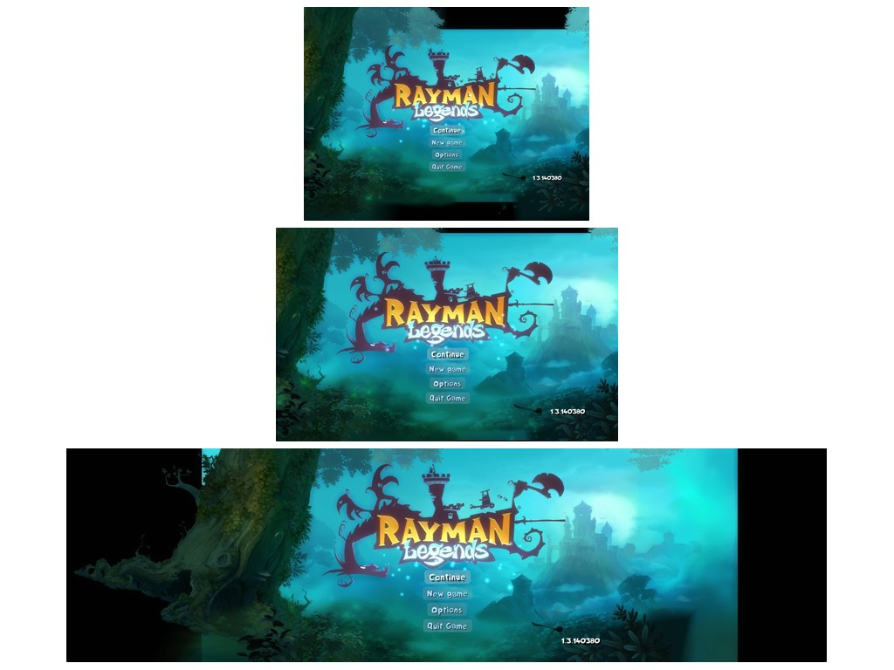

# Rayman-Legends-Any-Aspect-Ratio

[](https://github.com/TLin-Y/SteamAnyAspectRatioMods) [](https://ko-fi.com/lin66961)



Runs the game at any aspect ratio without black bars or stretching. Narrower screens keep the 16:9 side view and show more above and below; wider screens show more at the sides. Menus stay centred.

## Install

Extract `RaymanLegends_ARFix.asi`, `RaymanLegends_ARFix.ini`, and `dinput8.dll` into the game folder (beside `Rayman Legends.exe`).

## SteamOS / Winlator

Add the launch option:

```text
WINEDLLOVERRIDES="dinput8=n,b" %command%
```

## Settings

Edit `RaymanLegends_ARFix.ini` and restart the game:

```ini
[Resolution]
Width = 1280
Height = 800
```

The game starts at this resolution (default 1280 x 800, Steam Deck). Fullscreen or window is set in the game (Options > Window).

Wider than 16:9, the volume slider knobs in Options sit to the right of their bars.
