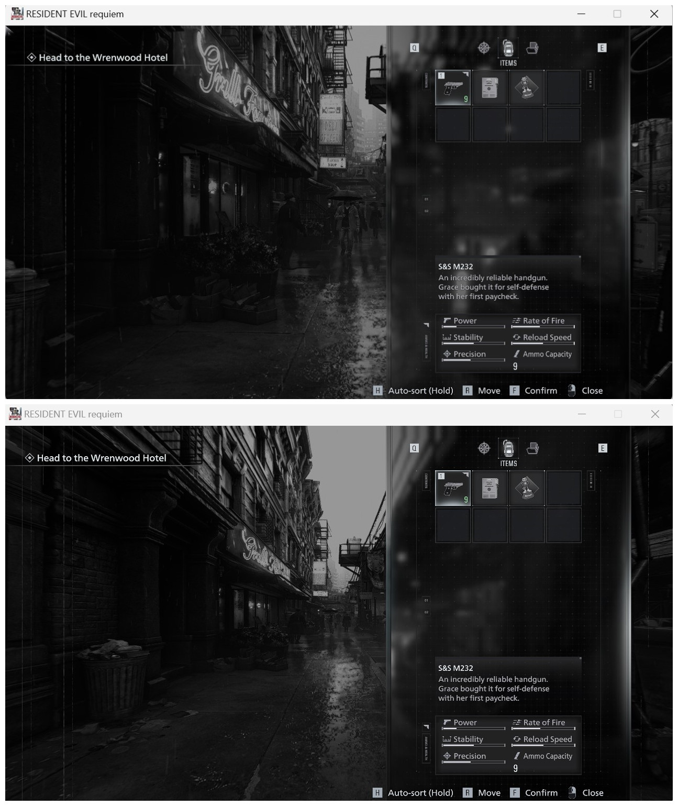

# RESIDENT-EVIL-REQUIEM-Any-Aspect-Ratio-and-FOV

Set the in-game resolution to your screen resolution (Steam Deck: 1280x800). The game now fills the whole screen with no black bars, including ultrawide and triple-monitor setups; no SteamOS display scaling needed.

Why?
- REFramework is incompatible with ARM64EC containers and can crash when its x86 instrumentation is dispatched. This mod applies aspect-ratio and FOV fixes without relying on REFramework.

1. Install

Extract the mod files directly into your game root folder (where re9.exe is located).

2. For SteamOS / Winlator (Wine Users)

For Steam Deck / SteamOS, open the game's Properties, then General > Launch Options, and use:
`WINEDLLOVERRIDES="dinput8=n,b" %command%`

For Winlator / Wine, add the following environment variable to the game or container settings:
Name: WINEDLLOVERRIDES
Value: dinput8=n,b

3. Custom Aspect Ratio & FOV

Customize the aspect ratio (AspectWidth / AspectHeight) and FOV (FOVScale) in RE9_ARFix.ini. The mod defaults to 16:10; set the ratio of your screen.

4. Full-Screen Stretching (old way)

The old way (in-game 1280x720 with SteamOS display scaling set to "Stretch") still works. To go back to the game's own black bars, set Enabled = false under [FitScreen] in RE9_ARFix.ini.

The bundled dinput8.dll is from Ultimate ASI Loader. Its MIT license is included in Resident-Evil-Requiem-v1.1.0.zip and in the repository root.
