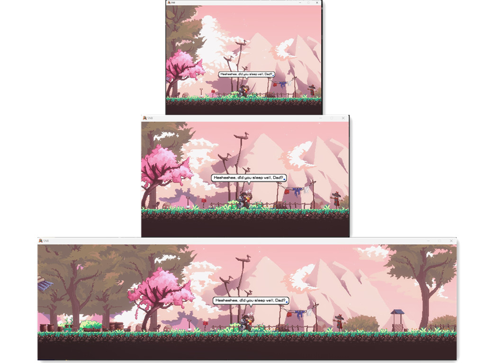

# SANABI-Any-Aspect-Ratio

This fix removes SANABI's camera aspect-ratio limits and adapts the view to the game's active render dimensions. It does not change the game resolution; choose the desired resolution in the game or launcher.

## Demo



## Install

1. Extract the archive into the game folder containing `SNB.exe`.
2. On SteamOS / Proton, set the Steam launch option to:
   `WINEDLLOVERRIDES="winmm=n,b" %command%`
3. On Winlator, add the environment variable `WINEDLLOVERRIDES` with value `winmm=n,b`.

## Custom Aspect Ratio

Choose a game resolution with the aspect ratio you want. The fix follows the active render dimensions automatically; it does not use fixed width/height values.

In `SNB_ARFix.ini`, `[AspectRatio] Enabled` turns the fix on or off. `MaintainFOV = true` preserves vertical framing when adapting the camera.

```ini
[AspectRatio]
Enabled = true
MaintainFOV = true
```
