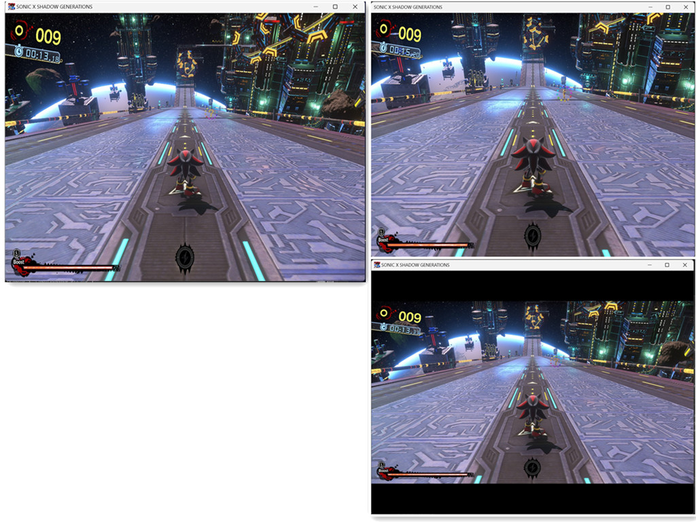
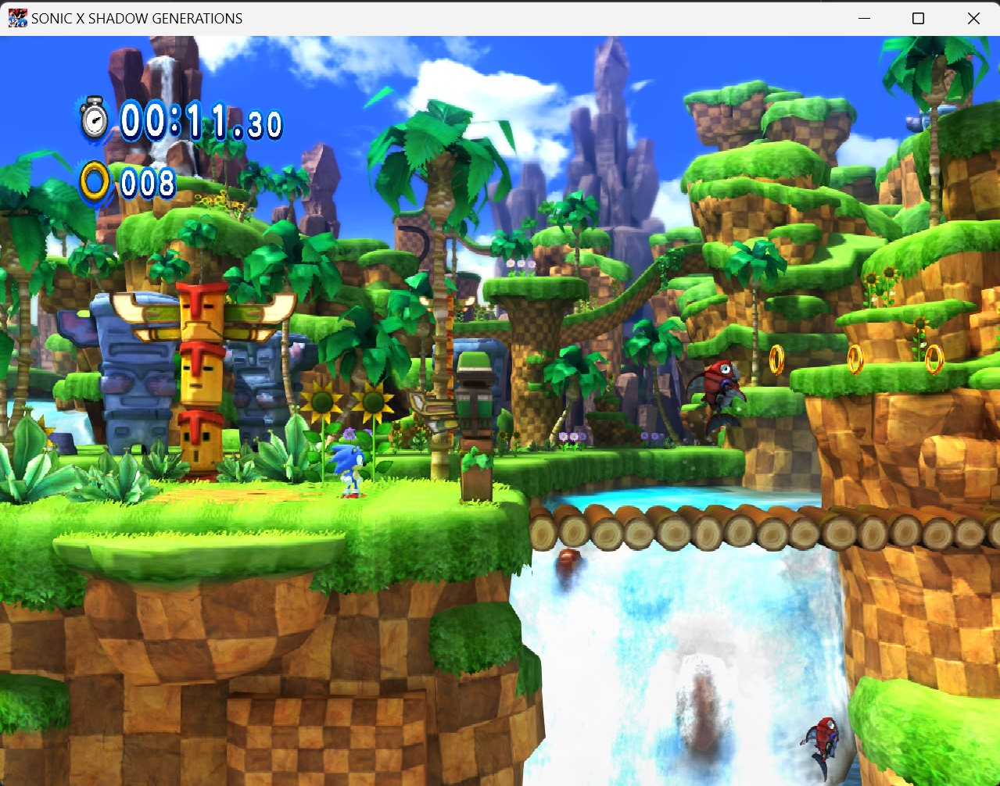

# SONIC X SHADOW GENERATIONS-Any-Aspect-Ratio

Use the game's built-in resolution setting for your display (for example, 1280x960 for 4:3, 11520x2160 for 48:9 etc.). The fixes use the actual final output size automatically.

## Install

1. Extract the zip into the game folder containing `SONIC_X_SHADOW_GENERATIONS.exe` and `SONIC_GENERATIONS.exe` (Steam: `steamapps\common\SONIC_X_SHADOW_GENERATIONS`).
2. Keep `winmm.dll`, `SonicShadow_ARFix.asi`, `GenerationsARFix.asi`, and `SonicShadow_ARFix.ini` together in that folder. The two ASIs fix Shadow Generations and Sonic Generations respectively. If upgrading from the old filename, remove `ShadowARFix.asi` to avoid loading the same fix twice.

## SteamOS / Winlator

Set the Steam launch option:

```text
WINEDLLOVERRIDES="winmm=n,b" %command%
```

## Custom Aspect Ratio

Select your desired resolution in the game. There are no Width/Height settings in the INI; both fixes use the actual final output size.

In `SonicShadow_ARFix.ini`, leave `CameraCorrection = true` and `RemoveLetterbox = true` in both `[Shadow]` and `[Generations]` for corrected proportions without letterboxing. Setting both to false retains original framing; mixed settings are for comparison and may distort proportions. Restart both games after editing. Diagnostics are disabled by default.

Both fixes write to `SonicShadow_ARFix.log`, which is available in the plugin's log viewer.

## Demos

Shadow Generations:  right shows the limitation of the existing community mod.



Sonic Generations:


